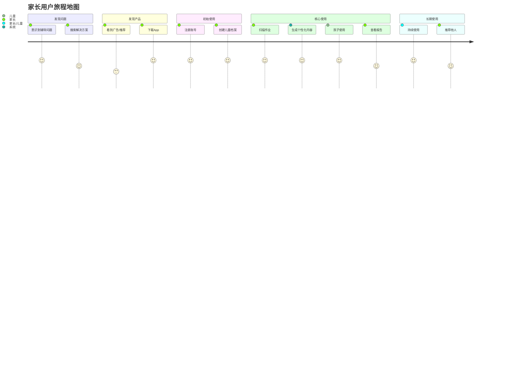
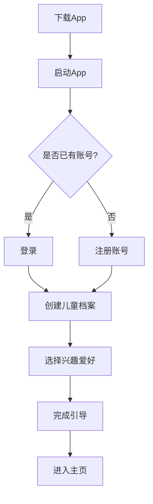
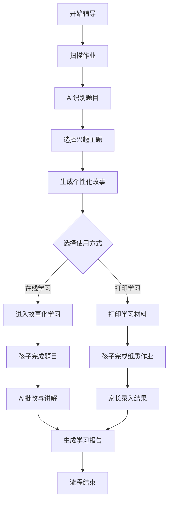

# AI赋能儿童作业辅导App - 产品需求文档

## 文档信息

| 项目名称 | 文档版本 | 状态 |
|---------|---------|------|
| 智趣作业辅导App | 1.1 | 评审中 |

## 修订历史

| 版本 | 修订内容 |
|------|---------|
| 1.0 | 初始版本创建 |
| 1.1 | 新增 2.4.3 单题个性化内容生成：扫描得出的一到多道题目，每道题可单独生成对应个性化内容 |

## 1. 产品概述

### 1.1 产品愿景
打造一个通过AI技术赋能，以儿童兴趣为导向的个性化作业辅导平台，让每个孩子都能在喜爱的故事情境中快乐学习，让家长从辅导压力中解放，实现"学习有趣，辅导无忧"。

### 1.2 产品目标
1. **用户体验目标**：
   - 儿童：学习过程有趣，提高学习兴趣和主动性
   - 家长：操作简单，辅导效果显著，节省时间
   
2. **商业目标**：
   - 6个月内上线MVP版本，获得首批1000名付费用户
   - 12个月内用户留存率达到40%
   - 18个月内实现盈亏平衡

3. **技术目标**：
   - AI生成内容准确率95%以上
   - 系统响应时间小于2秒
   - 99.5%的系统可用性

### 1.3 目标用户

#### 1.3.1 主要用户画像
**用户画像A：忙碌职场妈妈李女士**
- 年龄：35岁
- 职业：外企中层管理者
- 家庭：有一个8岁儿子（小学二年级）
- 痛点：工作繁忙，每天加班，晚上回家后精力不足，辅导孩子作业时容易急躁
- 需求：能让孩子主动完成作业，有专业辅导，减轻自己负担
- 使用场景：晚上7-9点，孩子做作业时间
- 设备：iPhone 13，iPad Pro

**用户画像B：教育焦虑型爸爸张先生**
- 年龄：40岁
- 职业：IT公司技术主管
- 家庭：有一个10岁女儿（小学四年级）
- 痛点：重视教育但缺乏方法，孩子对学习缺乏兴趣
- 需求：科学有效的辅导方法，激发孩子学习兴趣
- 使用场景：周末和晚上，辅导孩子学习
- 设备：华为Mate 50，Windows笔记本电脑

**用户画像C：学习困难儿童小明**
- 年龄：9岁
- 年级：小学三年级
- 兴趣：奥特曼、恐龙、科学实验
- 痛点：讨厌做作业，注意力不集中，数学成绩差
- 需求：有趣的学习方式，获得成就感
- 使用场景：每天放学后，做作业时间
- 设备：儿童专用平板

#### 1.3.2 用户旅程地图


### 1.4 成功标准
1. **产品成功指标**：
   - 用户满意度：NPS ≥ 50
   - 功能使用率：核心功能使用率 ≥ 70%
   - 系统性能：响应时间 ≤ 2秒，可用性 ≥ 99.5%

2. **业务成功指标**：
   - 用户增长：6个月付费用户 ≥ 1000
   - 用户留存：30日留存率 ≥ 40%
   - 收入目标：12个月月收入 ≥ 50万元

## 2. 功能需求

### 2.1 用户管理模块

#### 2.1.1 用户注册与登录
| 功能点 | 优先级 | 描述 | 验收标准 |
|--------|--------|------|---------|
| 手机号注册 | P0 | 用户通过手机号注册，接收验证码 | 1. 支持中国大陆手机号<br>2. 60秒后重新发送验证码<br>3. 验证码5分钟内有效 |
| 微信一键登录 | P1 | 支持微信授权登录 | 1. 获取用户微信头像和昵称<br>2. 自动创建账号<br>3. 支持绑定手机号 |
| 密码找回 | P1 | 通过手机验证码找回密码 | 1. 验证手机号后重置密码<br>2. 新密码需符合安全要求 |
| 用户协议与隐私政策 | P0 | 注册时必须同意 | 1. 清晰展示协议内容<br>2. 记录用户同意时间 |

#### 2.1.2 账户管理
| 功能点 | 优先级 | 描述 | 验收标准 |
|--------|--------|------|---------|
| 个人信息管理 | P1 | 修改昵称、头像、手机号 | 1. 支持上传头像<br>2. 修改手机号需验证原手机号 |
| 账户安全 | P1 | 修改密码、登录设备管理 | 1. 支持查看登录设备<br>2. 支持远程退出登录 |
| 订阅管理 | P0 | 查看和管理订阅状态 | 1. 显示当前订阅状态<br>2. 支持升级/降级/取消订阅 |

### 2.2 儿童档案管理

#### 2.2.1 儿童信息管理
| 功能点 | 优先级 | 描述 | 验收标准 |
|--------|--------|------|---------|
| 添加儿童档案 | P0 | 创建儿童学习档案 | 1. 基本信息：姓名、年龄、年级<br>2. 支持上传儿童头像<br>3. 一个账号最多支持3个儿童 |
| 兴趣爱好选择 | P0 | 选择儿童兴趣爱好标签 | 1. 提供20+个兴趣标签（奥特曼、海底小纵队、恐龙等）<br>2. 支持多选<br>3. 支持自定义兴趣标签 |
| 学习特点设置 | P1 | 设置儿童学习特点 | 1. 学习风格：视觉型/听觉型/综合型<br>2. 专注力时长：10/20/30分钟<br>3. 薄弱科目：语文/数学/英语 |
| 编辑与删除 | P1 | 管理儿童档案 | 1. 支持编辑所有信息<br>2. 删除需二次确认 |

#### 2.2.2 学习进度追踪
| 功能点 | 优先级 | 描述 | 验收标准 |
|--------|--------|------|---------|
| 学习数据记录 | P1 | 自动记录学习数据 | 1. 学习时长统计<br>2. 作业完成情况<br>3. 知识点掌握情况 |
| 学习报告生成 | P2 | 定期生成学习报告 | 1. 支持日报、周报、月报<br>2. 可视化展示学习数据<br>3. 提供学习建议 |

### 2.3 作业扫描与识别

#### 2.3.1 作业上传
| 功能点 | 优先级 | 描述 | 验收标准 |
|--------|--------|------|---------|
| 拍照扫描 | P0 | 通过相机拍摄作业 | 1. 支持自动对焦和裁剪<br>2. 支持多页连续拍摄<br>3. 图片质量检查 |
| 相册上传 | P0 | 从相册选择作业图片 | 1. 支持多图选择<br>2. 支持常见图片格式 |
| 作业信息标注 | P1 | 标注作业相关信息 | 1. 科目选择：语文/数学/英语<br>2. 紧急程度：今天/明天/后天完成 |

#### 2.3.2 AI识别与处理
| 功能点 | 优先级 | 描述 | 验收标准 |
|--------|--------|------|---------|
| OCR文字识别 | P0 | 识别图片中的文字 | 1. 支持中文、英文、数字识别<br>2. 识别准确率 ≥ 98%<br>3. 支持手写体识别 |
| 题目解析 | P0 | 解析题目类型和知识点 | 1. 识别题目类型：选择题/填空题/应用题等<br>2. 关联知识点<br>3. 支持数学公式识别 |
| 难度评估 | P1 | 评估题目难度等级 | 1. 分为简单/中等/困难三个等级<br>2. 根据年级标准评估 |

### 2.4 AI内容生成系统

#### 2.4.1 个性化故事生成
| 功能点 | 优先级 | 描述 | 验收标准 |
|--------|--------|------|---------|
| 故事主题匹配 | P0 | 根据兴趣生成故事主题 | 1. 匹配儿童选择的兴趣标签<br>2. 支持多种故事类型：冒险/科普/童话等 |
| 作业内容融入 | P0 | 将作业内容融入故事 | 1. 将题目转化为故事中的任务或问题<br>2. 保持题目原意不变<br>3. 自然融入故事场景 |
| 漫画/插图生成 | P1 | 为故事生成配图 | 1. 风格匹配儿童兴趣<br>2. 图片清晰，适合儿童观看<br>3. 生成时间 ≤ 10秒 |
| 语音合成 | P2 | 为故事生成语音 | 1. 支持儿童喜爱的语音风格<br>2. 可调节语速<br>3. 发音准确自然 |

#### 2.4.2 解题引导生成
| 功能点 | 优先级 | 描述 | 验收标准 |
|--------|--------|------|---------|
| 解题思路生成 | P0 | 生成分步解题思路 | 1. 步骤清晰，易于理解<br>2. 使用儿童能理解的语言<br>3. 结合兴趣元素讲解 |
| 知识点讲解 | P0 | 讲解相关知识点 | 1. 关联教材知识点<br>2. 提供示例和类比<br>3. 常见错误提醒 |
| 相似题目推荐 | P1 | 推荐相似题目练习 | 1. 基于当前题目知识点<br>2. 难度适配<br>3. 可生成新的故事化题目 |

#### 2.4.3 单题个性化内容生成
| 功能点 | 优先级 | 描述 | 验收标准 |
|--------|--------|------|---------|
| 按题目独立生成 | P0 | 扫描识别出的一到多道题目，每道题目均可单独生成对应的个性化内容 | 1. 在识别结果页/题目列表中对每道题提供「生成内容」入口<br>2. 单题生成时结合该题知识点与儿童兴趣，生成该题专属故事/解题引导<br>3. 支持批量选择多题后统一生成<br>4. 每道题生成的内容相互独立，可单独查看、使用 |
| 单题内容展示 | P1 | 按题目维度展示已生成的个性化内容 | 1. 题目列表显示各题生成状态（未生成/生成中/已完成）<br>2. 点击题目可进入该题的个性化内容学习界面 |

### 2.5 交互式学习界面

#### 2.5.1 故事阅读界面
| 功能点 | 优先级 | 描述 | 验收标准 |
|--------|--------|------|---------|
| 漫画式展示 | P0 | 以漫画形式展示故事 | 1. 支持左右滑动翻页<br>2. 图片清晰，加载快速<br>3. 支持放大查看 |
| 交互元素 | P1 | 故事中的交互点 | 1. 点击角色有互动反馈<br>2. 选择题可点击选择<br>3. 完成题目有奖励动画 |
| 阅读辅助 | P1 | 辅助阅读功能 | 1. 文字高亮跟随<br>2. 点击生字有拼音和解释<br>3. 书签功能 |

#### 2.5.2 在线作业界面
| 功能点 | 优先级 | 描述 | 验收标准 |
|--------|--------|------|---------|
| 题目展示 | P0 | 展示原题目和故事化题目 | 1. 并列显示两种形式<br>2. 支持切换查看<br>3. 清晰的答题区域 |
| 答题交互 | P0 | 支持多种答题方式 | 1. 选择题：点击选择<br>2. 填空题：键盘输入<br>3. 应用题：手写或键盘输入 |
| 实时反馈 | P0 | 答题后即时反馈 | 1. 正确：鼓励动画<br>2. 错误：提示再思考<br>3. 支持查看答案 |
| 提示系统 | P1 | 提供答题提示 | 1. 根据答题情况提供提示<br>2. 提示分级：轻微→详细→答案 |

#### 2.5.3 激励系统
| 功能点 | 优先级 | 描述 | 验收标准 |
|--------|--------|------|---------|
| 积分奖励 | P1 | 完成学习获得积分 | 1. 完成作业获得基础积分<br>2. 连续学习有额外奖励<br>3. 积分可兑换虚拟物品 |
| 成就系统 | P1 | 解锁学习成就 | 1. 预设多种成就徽章<br>2. 成就与学习行为关联<br>3. 成就墙展示 |
| 排行榜 | P2 | 学习成果排名 | 1. 周度/月度排行榜<br>2. 可设置匿名显示<br>3. 只显示同年级排名 |

### 2.6 家长管理后台

#### 2.6.1 学习监控
| 功能点 | 优先级 | 描述 | 验收标准 |
|--------|--------|------|---------|
| 实时进度查看 | P0 | 查看孩子当前学习状态 | 1. 当前学习科目和进度<br>2. 已用时长<br>3. 答题正确率 |
| 学习报告 | P0 | 查看详细学习报告 | 1. 学习时长统计<br>2. 各科掌握情况<br>3. 进步趋势分析 |
| 作业管理 | P1 | 管理孩子的作业 | 1. 查看历史作业<br>2. 重新生成内容<br>3. 导出学习报告 |

#### 2.6.2 设置与定制
| 功能点 | 优先级 | 描述 | 验收标准 |
|--------|--------|------|---------|
| 内容偏好设置 | P1 | 设置生成内容的偏好 | 1. 故事风格选择<br>2. 难度调整<br>3. 每日学习时长限制 |
| 通知设置 | P1 | 管理通知提醒 | 1. 作业完成通知<br>2. 学习报告推送<br>3. 可设置免打扰时段 |
| 隐私设置 | P0 | 隐私相关设置 | 1. 数据收集开关<br>2. 个性化推荐开关<br>3. 删除账户数据 |

### 2.7 打印功能

| 功能点 | 优先级 | 描述 | 验收标准 |
|--------|--------|------|---------|
| 内容预览 | P0 | 打印前预览内容 | 1. 显示打印效果<br>2. 支持调整页边距、字体大小 |
| 打印设置 | P0 | 设置打印参数 | 1. 选择打印机<br>2. 设置打印份数<br>3. 黑白/彩色打印 |
| 无线打印 | P1 | 支持无线打印机 | 1. 支持常见品牌无线打印机<br>2. 自动发现网络打印机 |

## 3. 非功能需求

### 3.1 性能需求
| 指标 | 要求 | 备注 |
|------|------|------|
| 系统响应时间 | 页面加载 ≤ 2秒，操作响应 ≤ 1秒 | 90%的请求 |
| 并发用户数 | 支持10000并发用户 | 峰值场景 |
| 系统可用性 | 99.5% | 每月故障时间 ≤ 3.6小时 |
| 数据准确性 | AI识别准确率 ≥ 95% | 核心功能 |

### 3.2 安全需求
1. **数据安全**：
   - 所有数据传输使用HTTPS加密
   - 敏感数据存储加密
   - 定期安全漏洞扫描
   
2. **隐私保护**：
   - 遵循儿童隐私保护法规
   - 最小化数据收集原则
   - 提供数据删除功能
   
3. **内容安全**：
   - AI生成内容审核机制
   - 敏感词过滤
   - 用户举报机制

### 3.3 兼容性需求
| 平台/设备 | 要求 | 备注 |
|-----------|------|------|
| iOS | 支持iOS 13及以上 | iPhone和iPad |
| Android | 支持Android 8.0及以上 | 主流品牌手机和平板 |
| 屏幕适配 | 适配主流屏幕尺寸 | 从手机到平板 |
| 网络环境 | 支持WiFi和移动网络 | 弱网环境优化 |

### 3.4 可扩展性需求
1. 支持模块化扩展，方便添加新功能
2. 数据库设计支持未来数据增长
3. 架构支持水平扩展
4. API设计支持第三方集成

### 3.5 易用性需求
1. **儿童界面**：
   - 大按钮，简洁明了
   - 鲜艳色彩，吸引注意力
   - 操作简单直观
   
2. **家长界面**：
   - 流程清晰，操作简单
   - 重要信息突出显示
   - 学习报告易于理解

## 4. 用户流程

### 4.1 核心用户流程

#### 4.1.1 首次使用流程


#### 4.1.2 作业辅导流程


### 4.2 异常流程
1. **网络异常处理**：
   - 网络断开时提示并保存本地
   - 网络恢复后自动同步
   
2. **识别失败处理**：
   - 图片模糊时提示重新拍摄
   - 识别错误时支持手动修改
   
3. **生成失败处理**：
   - AI生成失败时使用默认模板
   - 提供重试选项

## 5. 数据需求

### 5.1 数据模型

#### 5.1.1 核心数据表
```sql
-- 用户表
用户表 {
  user_id: PK
  手机号: string
  密码: encrypted string
  微信openid: string
  昵称: string
  头像: url
  注册时间: datetime
  最后登录时间: datetime
}

-- 儿童档案表
儿童档案表 {
  child_id: PK
  user_id: FK
  姓名: string
  年龄: int
  年级: enum
  头像: url
  兴趣标签: array
  学习风格: enum
  专注力时长: int
  创建时间: datetime
}

-- 作业记录表
作业记录表 {
  assignment_id: PK
  child_id: FK
  科目: enum
  题目内容: text
  题目图片: url
  难度等级: enum
  完成状态: enum
  开始时间: datetime
  完成时间: datetime
  正确率: float
}

-- 学习内容表
学习内容表 {
  content_id: PK
  assignment_id: FK
  故事内容: text
  漫画图片: array(url)
  语音文件: url
  生成时间: datetime
  兴趣主题: string
}

-- 学习记录表
学习记录表 {
  record_id: PK
  child_id: FK
  content_id: FK
  学习时长: int
  答题记录: json
  掌握程度: enum
  学习时间: datetime
}
```

### 5.2 数据统计需求
1. **用户数据**：
   - 日活跃用户数（DAU）
   - 月活跃用户数（MAU）
   - 新增用户数
   - 用户留存率
   
2. **学习数据**：
   - 平均学习时长
   - 作业完成率
   - 题目正确率
   - 知识点掌握情况
   
3. **业务数据**：
   - 付费用户数
   - 平均收入每用户（ARPU）
   - 用户生命周期价值（LTV）

## 6. 原型与交互说明

### 6.1 主要界面设计

#### 6.1.1 首页（家长端）
```
+-----------------------------------+
|  [儿童头像]小明今天的学习         |
|  今日已学习: 45分钟               |
|  完成作业: 数学练习册P10-12      |
|                                  |
|  [大按钮]开始新的辅导             |
|                                  |
|  最近学习记录                    |
|  · 语文-古诗背诵 ✓ 20分钟前      |
|  · 数学-加减法练习 ✓ 1小时前     |
|  · 英语-单词记忆 ✗ 昨天          |
|                                  |
|  [底部导航]                      |
|  首页 学习 报告 我的              |
+-----------------------------------+
```

#### 6.1.2 故事学习界面（儿童端）
```
+-----------------------------------+
|  [奥特曼背景图]                  |
|                                  |
|  小奥特曼的数学冒险              |
|  第3页/共8页                     |
|                                  |
|  [漫画区域]                      |
|  奥特曼遇到了一个难题:           |
|  5 + 3 = ?                       |
|                                  |
|  [答题区域]                      |
|  ○ 6    ○ 7    ○ 8    ○ 9       |
|                                  |
|  [提示按钮] [语音按钮] [下一题]  |
+-----------------------------------+
```

### 6.2 交互规范
1. **导航**：
   - 底部主导航，不超过5个标签
   - 重要操作使用悬浮按钮
   
2. **反馈**：
   - 操作成功：短暂提示
   - 操作失败：明确错误原因
   - 加载中：显示加载动画
   
3. **手势**：
   - 故事阅读：左右滑动翻页
   - 图片查看：双击放大，捏合缩放
   - 返回：右滑或点击返回按钮

## 7. 技术约束

### 7.1 技术栈选择
| 组件 | 技术选择 | 理由 |
|------|---------|------|
| 前端 | HBuilderX + uni-app | 跨平台，开发效率高，社区活跃 |
| 后端 | golang | 高性能，适合I/O密集型应用 |
| 数据库 | Mysql + Redis | 能用数据结构，高性能缓存 |
| AI服务 | Python + TensorFlow | AI生态完善，模型丰富 |
| 云服务 | 阿里云/腾讯云 | 国内用户访问快，服务稳定 |

### 7.2 第三方服务
1. **OCR识别**：百度OCR - PaddleOCR
2. **语音合成**：阿里云语音合成
3. **内容安全**：腾讯云内容安全
4. **推送服务**：极光推送
5. **统计分析**：神策数据

### 7.3 部署架构
```
用户设备 → CDN → 负载均衡 → Web服务器
                              ↓
                         应用服务器 → AI服务
                              ↓
                          数据库集群
```

## 8. 项目计划

### 8.1 开发阶段
| 阶段 | 主要交付物 |
|------|-----------|
| MVP开发 | 核心功能可用的App |
| 内测 | 修复Bug，优化体验 |
| 公测 | 正式上线1.0版本 |
| 迭代1 | 新增功能，优化性能 |
| 迭代2 | 高级功能，用户体验优化 |

### 8.2 资源需求
| 角色 | 职责 |
|------|------|
| 产品经理 | 需求、原型、项目管理 |
| UI/UX设计师 | 界面设计，用户体验 |
| iOS开发 | iOS客户端开发 |
| Android开发 | Android客户端开发 |
| 后端开发 | 服务端、API开发 |
| AI工程师 | AI模型训练、优化 |
| 测试工程师 | 测试、质量保证 |
| 总计 | 9 | | |

## 9. 风险评估与应对

### 9.1 技术风险
| 风险 | 可能性 | 影响 | 应对措施 |
|------|--------|------|---------|
| AI生成内容质量不达标 | 中 | 高 | 1. 建立人工审核机制<br>2. 多模型对比测试<br>3. 用户反馈快速迭代 |
| 系统性能不足 | 低 | 中 | 1. 压力测试<br>2. 性能监控<br>3. 可扩展架构设计 |
| 第三方服务不稳定 | 中 | 中 | 1. 多供应商备份<br>2. 服务降级方案<br>3. 客户端缓存 |

### 9.2 运营风险
| 风险 | 可能性 | 影响 | 应对措施 |
|------|--------|------|---------|
| 用户接受度低 | 中 | 高 | 1. 小范围用户测试<br>2. 快速迭代优化<br>3. 加强用户教育 |
| 内容安全问题 | 中 | 高 | 1. 建立审核机制<br>2. 敏感词过滤<br>3. 人工巡查 |
| 竞争加剧 | 高 | 中 | 1. 快速建立技术壁垒<br>2. 深耕细分市场<br>3. 建立用户社区 |

## 10. 成功度量指标

### 10.1 产品健康指标
| 指标 | 目标值 | 测量频率 |
|------|-------|---------|
| 日活跃用户/月活跃用户 | ≥ 0.4 | 每日 |
| 30日用户留存率 | ≥ 40% | 每日 |
| 平均使用时长 | ≥ 20分钟 | 每日 |
| 功能使用率 | ≥ 70% | 每周 |
| 用户满意度(NPS) | ≥ 50 | 每月 |

### 10.2 技术质量指标
| 指标 | 目标值 | 测量频率 |
|------|-------|---------|
| 应用崩溃率 | ≤ 0.1% | 每日 |
| API响应时间(P95) | ≤ 2秒 | 实时监控 |
| 系统可用性 | ≥ 99.5% | 实时监控 |
| AI识别准确率 | ≥ 95% | 每周 |

### 10.3 业务指标
| 指标 | 目标值 | 测量频率 |
|------|-------|---------|
| 付费用户转化率 | ≥ 5% | 每周 |
| 月经常性收入(MRR) | 6个月后 ≥ 10万 | 每月 |
| 用户获取成本(CAC) | ≤ 300元 | 每月 |
| 用户生命周期价值(LTV) | ≥ 3×CAC | 每月 | 运营经理 |

## 11. 附录

### 11.1 术语表
| 术语 | 解释 |
|------|------|
| OCR | 光学字符识别，将图片中的文字转换为可编辑文本 |
| AI生成 | 人工智能自动生成内容 |
| 兴趣图谱 | 描述儿童兴趣与知识点关联的数据模型 |
| ARPU | 每用户平均收入 |
| LTV | 用户生命周期价值 |
| CAC | 用户获取成本 |
| NPS | 净推荐值，衡量用户满意度的指标 |

### 11.2 相关文档
1. 商业需求文档
2. 技术架构文档
3. UI/UX设计规范
4. 测试计划
5. 运营推广计划

### 11.3 假设与依赖
1. **假设**：
   - 家长愿意为孩子教育付费
   - AI技术能满足内容生成需求
   - 儿童对个性化内容感兴趣
   
2. **依赖**：
   - 第三方AI服务稳定性
   - 应用商店审核通过
   - 初始用户获取渠道

## 12. 审批

| 角色 | 审批状态 | 签字 |
|------|---------|------|
| 产品总监 | 王五 | 产品部 | 同意 | | |
| 技术总监 | 赵六 | 技术部 | 同意 | | |
| 设计总监 | 钱七 | 设计部 | 同意 | | |
| 运营总监 | 孙八 | 运营部 | 同意 | | |
| CEO | 张三 | 管理层 | 批准 | | |

---

**文档状态**：本产品需求文档已通过初步评审，进入详细设计和开发阶段。

**下一步行动**：
1. 根据PRD进行详细UI/UX设计
2. 技术团队进行技术方案设计
3. 制定详细开发计划
4. 启动MVP版本开发