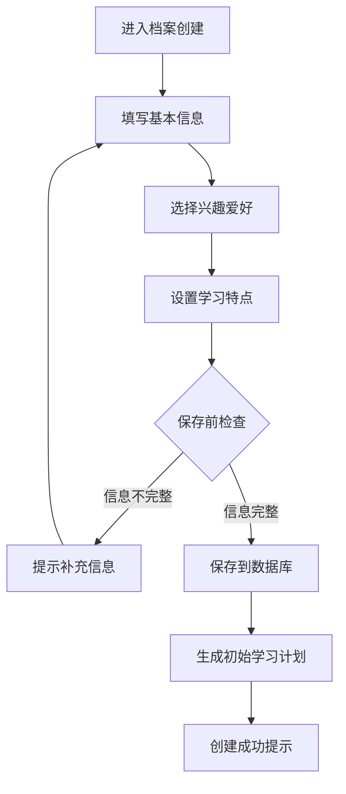
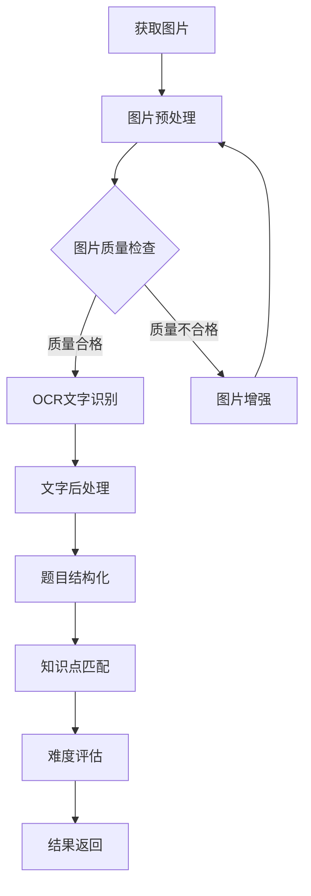
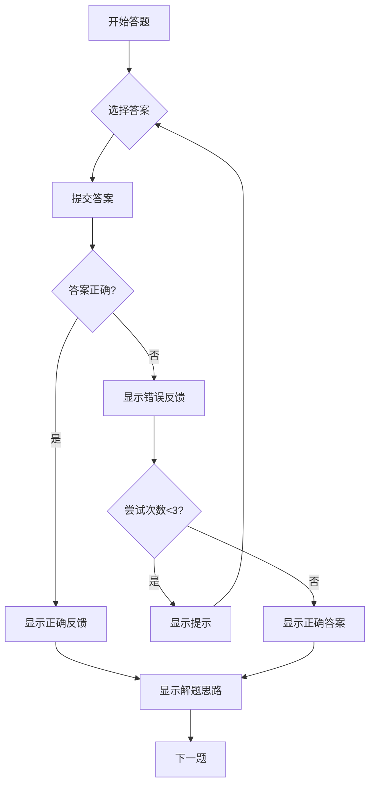
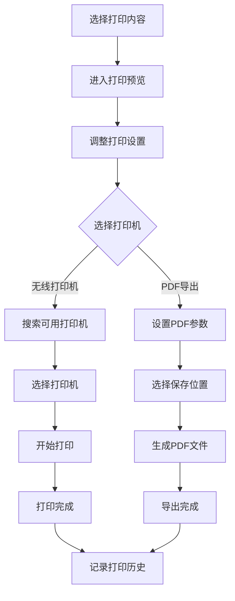

# AI赋能儿童作业辅导App - 核心功能规格说明书

## 文档信息

| 文档版本 | 1.0 |
|---------|-----|
| 状态 | 评审中 |

## 1. 文档概述

### 1.1 文档目的
本文档详细描述了"智趣作业辅导App"的核心功能规格，为开发团队提供明确、详细的技术实现指导，确保产品按照预定目标和质量标准进行开发。

### 1.2 阅读对象
- 产品经理和产品设计师
- 开发工程师（前端、后端、AI）
- 测试工程师
- 项目经理
- 运维工程师

### 1.3 功能优先级定义
- **P0**：核心功能，必须实现，MVP版本必备
- **P1**：重要功能，应在MVP版本中实现
- **P2**：优化功能，可在后续版本实现
- **P3**：锦上添花功能，低优先级

## 2. 儿童档案管理系统

### 2.1 功能概述
儿童档案是系统的核心数据基础，用于存储和管理儿童的个人信息、兴趣爱好、学习特点等，为个性化内容生成提供依据。

### 2.2 功能列表
| 功能模块 | 功能点 | 优先级 | 描述 |
|---------|-------|-------|------|
| 档案创建 | 基本信息录入 | P0 | 创建儿童档案，记录基础信息 |
| 档案创建 | 兴趣爱好选择 | P0 | 选择或自定义儿童兴趣爱好 |
| 档案创建 | 学习特点设置 | P1 | 记录学习习惯、薄弱科目等 |
| 档案管理 | 档案编辑 | P0 | 编辑已有儿童档案信息 |
| 档案管理 | 档案删除 | P0 | 删除儿童档案（软删除） |
| 档案管理 | 多儿童支持 | P1 | 支持一个账号管理多个儿童 |
| 兴趣管理 | 兴趣标签库 | P0 | 系统预设兴趣标签库 |
| 兴趣管理 | 自定义兴趣 | P1 | 支持家长自定义兴趣标签 |
| 学习跟踪 | 学习进度记录 | P1 | 自动记录学习数据 |
| 学习跟踪 | 学习报告生成 | P2 | 生成学习进度报告 |

### 2.3 详细规格说明

#### 2.3.1 儿童档案创建流程


**数据字段规格：**
```json
{
  "child_id": "uuid_v4",
  "user_id": "parent_user_id",
  "basic_info": {
    "name": "string, 2-10字符, 必填",
    "nickname": "string, 可选",
    "gender": "enum: male/female/unspecified, 必填",
    "birth_date": "date, 格式YYYY-MM-DD, 必填",
    "grade": "enum: 一年级/二年级/.../六年级, 必填",
    "avatar_url": "string, 头像URL, 可选"
  },
  "interests": {
    "preset_tags": ["奥特曼", "海底小纵队", "恐龙", "公主", "机器人"], 
    "custom_tags": ["string数组, 最大3个, 每个不超过5字符"],
    "updated_at": "datetime"
  },
  "learning_profile": {
    "learning_style": "enum: visual/auditory/kinesthetic/mixed, 默认mixed",
    "attention_span": "int, 分钟, 默认20, 范围10-60",
    "weak_subjects": ["语文", "数学", "英语"], 
    "preferred_time": ["19:00-20:00", "周末上午"],
    "created_at": "datetime"
  },
  "learning_data": {
    "total_study_time": "int, 分钟, 默认0",
    "completed_assignments": "int, 默认0",
    "average_score": "float, 默认0.0",
    "last_study_date": "datetime"
  },
  "system_fields": {
    "is_active": "boolean, 默认true",
    "created_at": "datetime",
    "updated_at": "datetime"
  }
}
```

**业务规则：**
1. 一个家长账号最多可创建3个儿童档案
2. 儿童姓名必填，长度为2-10个字符
3. 年龄根据出生日期自动计算，范围为3-12岁
4. 年级可手动调整，不自动与年龄绑定
5. 兴趣爱好预设标签库包含至少20个常用标签
6. 自定义标签每个不超过5个字符，最多3个
7. 学习风格基于VARK模型（视觉/听觉/读写/动觉）

#### 2.3.2 兴趣标签管理
**预设标签库分类：**
```
动漫类: 奥特曼, 小猪佩奇, 超级飞侠, 汪汪队, 海底小纵队
科幻类: 机器人, 太空, 外星人, 未来世界
自然类: 恐龙, 动物世界, 植物, 海洋生物
童话类: 公主, 王子, 魔法, 城堡
运动类: 足球, 篮球, 游泳, 跑步
职业类: 医生, 警察, 消防员, 科学家
其他: 美食, 汽车, 积木, 音乐
```

**兴趣匹配算法：**
```python
def match_interest_tags(child_interests, subject, topic):
    """
    根据儿童兴趣、科目和知识点匹配兴趣标签
    """
    # 预设匹配规则
    interest_mapping = {
        "数学": {
            "加减法": ["奥特曼打怪兽", "海底小纵队救援", "恐龙数数"],
            "几何": ["积木搭建", "城堡设计", "太空站构造"],
            "应用题": ["购物计算", "时间规划", "分享食物"]
        },
        "语文": {
            "古诗词": ["古诗里的故事", "诗人历险记", "诗词中的风景"],
            "阅读理解": ["故事分析", "角色扮演", "情节推理"],
            "写作": ["写自己的冒险", "描述喜欢的角色", "创作小故事"]
        },
        "英语": {
            "单词": ["单词冒险", "字母探险", "外语交流"],
            "对话": ["角色对话", "情景模拟", "动画配音"],
            "阅读": ["英文故事", "双语漫画", "国际交流"]
        }
    }
    
    # 优先匹配儿童选择的兴趣
    for interest in child_interests:
        if interest in interest_mapping.get(subject, {}).get(topic, []):
            return interest
    
    # 默认匹配第一个兴趣
    return child_interests[0] if child_interests else "通用"
```

## 3. 作业扫描与识别系统

### 3.1 功能概述
通过手机摄像头拍摄作业图片，使用OCR技术识别题目内容，并进行结构化处理，为后续的个性化内容生成提供输入。

### 3.2 功能列表
| 功能模块 | 功能点 | 优先级 | 描述 |
|---------|-------|-------|------|
| 图片获取 | 拍照扫描 | P0 | 通过相机拍摄作业图片 |
| 图片获取 | 相册上传 | P0 | 从相册选择作业图片 |
| 图片处理 | 自动裁剪 | P0 | 自动识别并裁剪作业区域 |
| 图片处理 | 图片增强 | P1 | 调整亮度、对比度、矫正角度 |
| 文字识别 | OCR识别 | P0 | 识别图片中的文字内容 |
| 题目解析 | 题目分割 | P0 | 将识别内容分割为单个题目 |
| 题目解析 | 类型识别 | P0 | 识别题目类型（选择/填空/计算等） |
| 题目解析 | 知识点提取 | P0 | 提取题目涉及的知识点 |
| 题目解析 | 难度评估 | P1 | 评估题目难度等级 |
| 结果处理 | 识别结果编辑 | P0 | 手动修正识别错误 |
| 结果处理 | 题目信息补充 | P1 | 手动补充题目信息 |

### 3.3 详细规格说明

#### 3.3.1 图片处理流程


**图片质量要求：**
| 参数 | 要求 | 说明 |
|------|------|------|
| 分辨率 | ≥ 800×600像素 | 保证文字清晰可识别 |
| 文件大小 | ≤ 5MB | 考虑网络传输和存储 |
| 格式支持 | JPG, PNG, WebP | 常见图片格式 |
| 拍摄角度 | 偏角 ≤ 30度 | 支持自动矫正 |
| 光照条件 | 无明显阴影/反光 | 可进行光照补偿 |

**OCR接口规格：**
```javascript
// 请求参数
{
  "image_data": "base64编码的图片数据",
  "image_url": "图片URL（二选一）",
  "options": {
    "language": "zh_CN,en",  // 中英文混合
    "detect_direction": true,  // 检测方向
    "detect_math": true,  // 检测数学公式
    "paragraph": true  // 段落识别
  }
}

// 响应数据
{
  "status": "success",
  "data": {
    "text": "识别出的完整文本",
    "words": [
      {
        "word": "单词",
        "location": { "left": 10, "top": 20, "width": 50, "height": 30 },
        "confidence": 0.95
      }
    ],
    "paragraphs": [
      {
        "text": "段落文本",
        "location": { /* 位置信息 */ },
        "lines": [ /* 行信息 */ ]
      }
    ],
    "math_expressions": [ /* 数学表达式 */ ]
  }
}
```

#### 3.3.2 题目解析与结构化
**题目数据结构：**
```json
{
  "assignment_id": "uuid_v4",
  "child_id": "关联儿童ID",
  "subject": "enum: 语文/数学/英语/科学",
  "grade": "enum: 一年级/二年级/...",
  "source_image_url": "原始图片URL",
  "questions": [
    {
      "question_id": "uuid_v4",
      "question_number": "int, 题号",
      "question_type": "enum: 选择题/填空题/计算题/应用题/问答题",
      "original_text": "题目原始文本",
      "structured_data": {
        "stem": "题干文本",
        "options": [
          {"option": "A", "text": "选项A内容"},
          {"option": "B", "text": "选项B内容"}
        ],
        "answer": "参考答案",
        "analysis": "解题分析"
      },
      "knowledge_points": [
        {
          "subject": "数学",
          "topic": "加减法",
          "subtopic": "20以内加减法",
          "difficulty": "enum: easy/medium/hard"
        }
      ],
      "metadata": {
        "word_count": 150,
        "has_image": false,
        "has_formula": true,
        "confidence": 0.92
      }
    }
  ],
  "metadata": {
    "page_count": 1,
    "total_questions": 10,
    "average_difficulty": "medium",
    "estimated_time": 30,  // 分钟
    "scan_quality": 0.95
  }
}
```

**题目类型识别规则：**
```python
def identify_question_type(text):
    """
    识别题目类型
    """
    text_lower = text.lower()
    
    # 选择题识别
    if re.search(r'[A-D][\.、．]', text_lower) or re.search(r'[①②③④]', text):
        options = extract_options(text)
        if len(options) >= 2:
            return "multiple_choice"
    
    # 填空题识别
    if re.search(r'[_]{2,}', text) or re.search(r'[（(][   ]+[）)]', text):
        return "fill_blank"
    
    # 计算题识别
    if re.search(r'[0-9\+\-\×÷\*\/=]+', text) and not re.search(r'[A-Za-z]', text):
        return "calculation"
    
    # 应用题识别
    if len(text) > 50 and re.search(r'[多少几]\?|问题[:：]', text):
        return "word_problem"
    
    # 默认为问答题
    return "essay"

def extract_options(text):
    """
    提取选择题选项
    """
    options = []
    patterns = [
        r'([A-D])[\.、．]\s*(.+?)(?=[A-D][\.、．]|$)',
        r'([①②③④])\s*(.+?)(?=[①②③④]|$)'
    ]
    
    for pattern in patterns:
        matches = re.findall(pattern, text, re.MULTILINE)
        for match in matches:
            options.append({
                "option": match[0],
                "text": match[1].strip()
            })
    
    return options
```

**难度评估算法：**
```python
def evaluate_difficulty(question, child_grade):
    """
    评估题目难度
    """
    difficulty_score = 0
    
    # 基于年级的基准难度
    grade_difficulty = {
        "一年级": 1, "二年级": 2, "三年级": 3,
        "四年级": 4, "五年级": 5, "六年级": 6
    }
    
    # 文本长度因素
    word_count = len(question.get("original_text", ""))
    if word_count > 100:
        difficulty_score += 2
    elif word_count > 50:
        difficulty_score += 1
    
    # 题目类型因素
    type_weights = {
        "multiple_choice": 1,
        "fill_blank": 2,
        "calculation": 2,
        "word_problem": 3,
        "essay": 4
    }
    difficulty_score += type_weights.get(question.get("question_type", ""), 0)
    
    # 知识点数量
    knowledge_count = len(question.get("knowledge_points", []))
    difficulty_score += min(knowledge_count, 3)
    
    # 标准化难度等级
    max_difficulty = 10
    normalized_score = min(difficulty_score / max_difficulty, 1.0)
    
    if normalized_score < 0.3:
        return "easy"
    elif normalized_score < 0.7:
        return "medium"
    else:
        return "hard"
```

## 4. AI内容生成系统

### 4.1 功能概述
基于儿童兴趣爱好和作业题目，自动生成个性化的故事化学习内容，包括故事文本、漫画插图、解题思路等。

### 4.2 功能列表
| 功能模块 | 功能点 | 优先级 | 描述 |
|---------|-------|-------|------|
| 故事生成 | 主题匹配 | P0 | 根据兴趣匹配故事主题 |
| 故事生成 | 题目融合 | P0 | 将题目融入故事场景 |
| 故事生成 | 文本生成 | P0 | 生成故事文本内容 |
| 插图生成 | 场景生成 | P1 | 根据故事生成场景描述 |
| 插图生成 | 图片生成 | P1 | 生成漫画风格插图 |
| 解题引导 | 解题思路生成 | P0 | 生成分步解题思路 |
| 解题引导 | 知识点讲解 | P0 | 讲解相关知识点 |
| 解题引导 | 错误分析 | P1 | 分析常见错误 |
| 语音合成 | 文本转语音 | P2 | 生成故事语音 |
| 内容审核 | 安全过滤 | P0 | 审核生成内容安全性 |

### 4.3 详细规格说明

#### 4.3.1 个性化故事生成
**故事生成流程：**
```
输入: 题目信息 + 儿童兴趣 + 儿童档案
输出: 个性化故事文本 + 插图描述
步骤:
1. 主题选择: 根据兴趣选择故事主题
2. 角色设定: 创建主角和配角
3. 场景构建: 创建故事场景
4. 题目融入: 将题目转化为故事任务
5. 情节发展: 构建故事发展
6. 结局设计: 设计故事结局
```

**故事模板示例（奥特曼主题的数学题）：**
```json
{
  "template_id": "ultraman_math_001",
  "interest": "奥特曼",
  "subject": "数学",
  "topic": "加法",
  "difficulty": "easy",
  "template": {
    "title": "奥特曼的能量收集任务",
    "characters": [
      {
        "name": "赛罗奥特曼",
        "role": "主角",
        "description": "勇敢的光之战士"
      },
      {
        "name": "贝利亚",
        "role": "反派",
        "description": "想要破坏地球的怪兽"
      }
    ],
    "scenes": [
      {
        "scene": 1,
        "description": "赛罗奥特曼接到了地球防卫队的紧急通知",
        "task": "计算需要收集的能量块数量"
      },
      {
        "scene": 2,
        "description": "赛罗奥特曼在火星找到了{num1}个能量块",
        "task": "记录当前能量块数量"
      },
      {
        "scene": 3,
        "description": "赛罗奥特曼又在木星找到了{num2}个能量块",
        "task": "计算总共有多少个能量块"
      }
    ],
    "questions": [
      {
        "original_question": "{num1} + {num2} = ?",
        "story_question": "赛罗奥特曼一共找到了多少个能量块？",
        "answer": "{num1 + num2}"
      }
    ],
    "ending": "赛罗奥特曼收集了足够的能量，成功打败了贝利亚，保护了地球！"
  }
}
```

**内容生成API规格：**
```javascript
// 请求参数
{
  "question_data": { /* 题目结构化数据 */ },
  "child_profile": { /* 儿童档案数据 */ },
  "generation_config": {
    "story_style": "adventure",  // 冒险/科幻/童话等
    "character_count": 2,  // 角色数量
    "scene_count": 3,  // 场景数量
    "difficulty": "easy",  // 故事难度
    "include_humor": true,  // 包含幽默元素
    "moral_lesson": "勇敢"  // 传递的价值观
  }
}

// 响应数据
{
  "status": "success",
  "data": {
    "story": {
      "title": "奥特曼的能量收集任务",
      "scenes": [
        {
          "scene_number": 1,
          "text": "赛罗奥特曼接到了地球防卫队的紧急通知，贝利亚怪兽正在攻击地球！",
          "illustration_prompt": "奥特曼接到紧急通知的场景，充满紧张感",
          "duration_seconds": 15
        }
      ],
      "total_scenes": 3,
      "total_words": 250,
      "estimated_reading_time": 90  // 秒
    },
    "illustrations": [
      {
        "scene_number": 1,
        "image_url": "https://cdn.example.com/images/ultraman_scene1.jpg",
        "description": "奥特曼在指挥中心接到紧急通知"
      }
    ],
    "questions": [
      {
        "original": "5 + 3 = ?",
        "integrated": "赛罗奥特曼在火星找到了5个能量块，在木星又找到了3个，一共多少个？",
        "answer": 8,
        "hints": [
          "先数一数火星的能量块",
          "再数一数木星的能量块",
          "把两个数字加在一起"
        ]
      }
    ]
  }
}
```

#### 4.3.2 解题引导生成
**解题步骤生成算法：**
```python
def generate_solution_steps(question, child_interests):
    """
    生成分步解题引导
    """
    steps = []
    
    # 基于题目类型生成不同的解题步骤
    if question["question_type"] == "multiple_choice":
        steps = generate_multiple_choice_steps(question, child_interests)
    elif question["question_type"] == "calculation":
        steps = generate_calculation_steps(question, child_interests)
    elif question["question_type"] == "word_problem":
        steps = generate_word_problem_steps(question, child_interests)
    else:
        steps = generate_general_steps(question, child_interests)
    
    return steps

def generate_calculation_steps(question, interests):
    """
    生成计算题的解题步骤
    """
    steps = []
    
    # 解析题目
    expression = extract_math_expression(question["original_text"])
    
    if not expression:
        return [{"step": 1, "text": "请仔细阅读题目", "hint": "看看题目要求我们算什么"}]
    
    # 根据兴趣选择不同的引导方式
    if "奥特曼" in interests:
        steps.append({
            "step": 1,
            "text": f"小奥特曼，我们先来看看这个算式：{expression}",
            "voice": "让我们像奥特曼一样勇敢地解决这个数学问题！",
            "illustration": "奥特曼看着算式的场景"
        })
    else:
        steps.append({
            "step": 1,
            "text": f"我们一起来看看这个算式：{expression}",
            "voice": "这是一个有趣的数学问题，让我们一起来解决它！",
            "illustration": "小朋友思考数学题的场景"
        })
    
    # 分步骤解题
    operators = re.findall(r'[\+\-\×÷]', expression)
    numbers = re.findall(r'\d+', expression)
    
    if len(operators) == 1 and len(numbers) == 2:
        operator = operators[0]
        num1, num2 = map(int, numbers)
        
        steps.append({
            "step": 2,
            "text": f"首先，我们有数字{num1}和{num2}，中间是{operator}号",
            "voice": f"这里有{num1}和{num2}两个数字，我们要做{operator_map[operator]}运算",
            "hint": f"{operator_map.get(operator, '')}的意思是..."
        })
        
        # 计算结果
        result = calculate_expression(expression)
        
        steps.append({
            "step": 3,
            "text": f"{num1} {operator} {num2} = {result}",
            "voice": f"所以答案是{result}，你答对了吗？",
            "illustration": f"展示{num1}{operator}{num2}={result}的计算过程"
        })
    
    return steps

# 运算符映射
operator_map = {
    "+": "加",
    "-": "减",
    "×": "乘",
    "÷": "除"
}
```

## 5. 交互式学习平台

### 5.1 功能概述
提供儿童友好的交互界面，让孩子在有趣的故事环境中完成作业，并获得即时反馈和激励。

### 5.2 功能列表
| 功能模块 | 功能点 | 优先级 | 描述 |
|---------|-------|-------|------|
| 故事阅读 | 漫画展示 | P0 | 以漫画形式展示故事 |
| 故事阅读 | 翻页控制 | P0 | 左右滑动翻页 |
| 故事阅读 | 语音朗读 | P1 | 自动朗读故事内容 |
| 作业界面 | 题目展示 | P0 | 展示原题和故事化题目 |
| 作业界面 | 答题交互 | P0 | 支持多种答题方式 |
| 作业界面 | 即时反馈 | P0 | 答题后即时反馈 |
| 作业界面 | 提示系统 | P1 | 提供分级提示 |
| 激励系统 | 积分奖励 | P1 | 完成学习获得积分 |
| 激励系统 | 成就系统 | P1 | 解锁学习成就 |
| 激励系统 | 进度展示 | P1 | 展示学习进度 |
| 学习报告 | 成绩报告 | P1 | 展示学习成绩 |
| 学习报告 | 进步分析 | P2 | 分析学习进步情况 |

### 5.3 详细规格说明

#### 5.3.1 故事阅读界面
**界面布局规格：**
```javascript
// 故事阅读界面数据结构
{
  "story_id": "uuid_v4",
  "title": "奥特曼的能量收集任务",
  "current_page": 1,
  "total_pages": 5,
  "pages": [
    {
      "page_number": 1,
      "type": "cover",  // cover/story/question/result
      "content": {
        "illustration": {
          "url": "https://example.com/image1.jpg",
          "alt_text": "奥特曼接到紧急通知",
          "interactive_elements": [
            {
              "type": "character",
              "id": "ultraman",
              "position": { "x": 100, "y": 200, "width": 80, "height": 120 },
              "action": "tap_to_speak",
              "speech": "我是赛罗奥特曼！"
            }
          ]
        },
        "text": {
          "content": "赛罗奥特曼接到了地球防卫队的紧急通知...",
          "font_size": 18,
          "line_height": 1.5,
          "highlight_words": ["紧急通知", "贝利亚怪兽"]
        },
        "narration": {
          "audio_url": "https://example.com/audio1.mp3",
          "duration": 15,
          "text_highlight": true
        }
      },
      "navigation": {
        "next_page": 2,
        "has_previous": false,
        "has_next": true
      }
    }
  ],
  "interaction_log": [
    {
      "page": 1,
      "interaction_type": "page_view",
      "timestamp": "2026-01-21T10:00:00Z",
      "duration_seconds": 25
    }
  ]
}
```

**交互规格：**
1. **翻页控制**：
   - 支持左右滑动翻页
   - 支持点击左右箭头翻页
   - 支持进度条跳转
   
2. **阅读辅助**：
   - 点击生字显示拼音和解释
   - 自动朗读，支持播放/暂停
   - 文字高亮跟随朗读进度
   
3. **互动元素**：
   - 可点击角色有互动反馈
   - 隐藏的探索元素
   - 简单的动画效果

#### 5.3.2 在线作业界面
**答题交互规格：**
```javascript
// 答题界面状态管理
{
  "question_id": "uuid_v4",
  "question_type": "multiple_choice",
  "question_data": {
    "stem": "奥特曼一共找到了多少个能量块？",
    "options": [
      {"id": "A", "text": "6个", "is_correct": false},
      {"id": "B", "text": "7个", "is_correct": false},
      {"id": "C", "text": "8个", "is_correct": true},
      {"id": "D", "text": "9个", "is_correct": false}
    ],
    "correct_answer": "C",
    "explanation": "火星5个 + 木星3个 = 8个能量块"
  },
  "user_answer": null,
  "answer_status": "unanswered",  // unanswered/answered/correct/incorrect
  "hints_shown": 0,
  "max_hints": 3,
  "hints": [
    "看看火星有几个能量块？",
    "再看看木星有几个能量块？",
    "把两个数字加在一起看看"
  ],
  "time_spent": 0,  // 秒
  "max_time": 300,  // 5分钟
  "attempts": 0,
  "max_attempts": 3
}
```

**答题反馈流程：**


**反馈消息规格：**
```javascript
// 正确反馈
const correctFeedbacks = [
  "太棒了！你真是个数学小天才！",
  "完全正确！奥特曼为你点赞！",
  "做对了！你的计算又快又准！",
  "正确！看来你已经掌握了这个知识点！"
];

// 错误反馈
const incorrectFeedbacks = [
  "别灰心，再仔细想想！",
  "这个有点难，要不要看看提示？",
  "就差一点了，再试试看！",
  "这个答案不太对，让我们看看哪里出错了"
];

// 提示消息
const hintMessages = [
  "提示1: 先看看题目问的是什么",
  "提示2: 注意题目中的关键数字",
  "提示3: 想想我们之前学过的计算方法"
];
```

#### 5.3.3 激励系统
**积分规则：**
```javascript
// 积分获取规则
const pointRules = {
  "complete_assignment": {
    "base_points": 10,
    "bonus_multiplier": 1.5,  // 连续完成加成
    "max_per_day": 100
  },
  "correct_answer": {
    "points": 2,
    "first_try_bonus": 5
  },
  "daily_login": {
    "points": 5,
    "streak_multiplier": [1, 1.2, 1.5, 2]  // 连续登录加成
  },
  "share_achievement": {
    "points": 10,
    "limit_per_day": 1
  }
};

// 积分兑换规则
const redemptionRules = [
  {
    "id": "avatar_frame_1",
    "name": "金色头像框",
    "cost": 100,
    "type": "avatar_frame"
  },
  {
    "id": "story_unlock_1",
    "name": "特别故事章节",
    "cost": 50,
    "type": "content"
  },
  {
    "id": "hint_pack",
    "name": "提示礼包（5个）",
    "cost": 30,
    "type": "utility"
  }
];
```

**成就系统：**
```javascript
// 成就定义
const achievements = [
  {
    "id": "first_assignment",
    "name": "第一次作业",
    "description": "完成第一次作业",
    "icon": "🎯",
    "points": 10,
    "condition": "assignments_completed >= 1"
  },
  {
    "id": "math_master",
    "name": "数学小能手",
    "description": "连续5天完成数学作业",
    "icon": "🔢",
    "points": 30,
    "condition": "math_streak >= 5"
  },
  {
    "id": "fast_learner",
    "name": "快速学习者",
    "description": "10分钟内完成作业",
    "icon": "⚡",
    "points": 20,
    "condition": "avg_completion_time < 600"  // 10分钟
  },
  {
    "id": "perfectionist",
    "name": "完美主义者",
    "description": "连续3次作业全对",
    "icon": "🏆",
    "points": 50,
    "condition": "perfect_streak >= 3"
  }
];
```

## 6. 家长管理后台

### 6.1 功能概述
为家长提供全面的学习监控和管理功能，让家长了解孩子的学习情况，并进行适当的设置和调整。

### 6.2 功能列表
| 功能模块 | 功能点 | 优先级 | 描述 |
|---------|-------|-------|------|
| 学习监控 | 实时进度 | P0 | 查看孩子当前学习状态 |
| 学习监控 | 历史记录 | P0 | 查看历史学习记录 |
| 学习监控 | 成绩报告 | P0 | 查看学习成绩报告 |
| 作业管理 | 作业查看 | P0 | 查看已完成的作业 |
| 作业管理 | 作业重做 | P1 | 重新生成作业内容 |
| 作业管理 | 作业分享 | P2 | 分享作业成果 |
| 设置管理 | 内容偏好 | P1 | 设置生成内容的偏好 |
| 设置管理 | 时间控制 | P1 | 设置学习时间限制 |
| 设置管理 | 通知设置 | P1 | 管理通知提醒 |
| 账户管理 | 订阅管理 | P0 | 管理订阅状态 |
| 账户管理 | 隐私设置 | P0 | 隐私相关设置 |

### 6.3 详细规格说明

#### 6.3.1 学习监控
**实时学习状态数据结构：**
```javascript
{
  "child_id": "uuid_v4",
  "current_session": {
    "status": "active",  // active/completed/paused
    "subject": "数学",
    "assignment_id": "uuid_v4",
    "start_time": "2026-01-21T10:00:00Z",
    "elapsed_time": 600,  // 秒
    "current_question": 3,
    "total_questions": 10,
    "correct_count": 2,
    "incorrect_count": 1
  },
  "daily_summary": {
    "date": "2026-01-21",
    "total_study_time": 1800,  // 秒
    "completed_assignments": 2,
    "subjects": [
      {
        "subject": "数学",
        "time_spent": 1200,
        "correct_rate": 0.85,
        "questions_attempted": 20
      },
      {
        "subject": "语文",
        "time_spent": 600,
        "correct_rate": 0.9,
        "questions_attempted": 10
      }
    ],
    "achievements_unlocked": ["first_assignment", "fast_learner"]
  }
}
```

**学习报告生成规则：**
```python
def generate_learning_report(child_id, start_date, end_date):
    """
    生成学习报告
    """
    # 获取学习数据
    study_data = get_study_data(child_id, start_date, end_date)
    
    report = {
        "period": f"{start_date} 至 {end_date}",
        "summary": {
            "total_study_time": sum(d["study_time"] for d in study_data),
            "total_assignments": len(study_data),
            "average_correct_rate": calculate_average(study_data, "correct_rate"),
            "days_studied": len(set(d["date"] for d in study_data))
        },
        "subject_analysis": {},
        "progress_analysis": {},
        "recommendations": []
    }
    
    # 科目分析
    for subject in ["数学", "语文", "英语"]:
        subject_data = [d for d in study_data if d["subject"] == subject]
        if subject_data:
            report["subject_analysis"][subject] = {
                "study_time": sum(d["study_time"] for d in subject_data),
                "average_correct_rate": calculate_average(subject_data, "correct_rate"),
                "weak_topics": identify_weak_topics(subject_data)
            }
    
    # 进步分析
    report["progress_analysis"] = analyze_progress(study_data)
    
    # 个性化建议
    report["recommendations"] = generate_recommendations(report)
    
    return report

def generate_recommendations(report):
    """
    生成个性化学习建议
    """
    recommendations = []
    
    # 基于学习时间
    total_time = report["summary"]["total_study_time"]
    if total_time < 1800:  # 少于30分钟/天
        recommendations.append({
            "type": "study_time",
            "title": "增加学习时间",
            "content": "建议每天学习时间增加到30分钟以上",
            "priority": "high"
        })
    
    # 基于正确率
    for subject, data in report["subject_analysis"].items():
        if data["average_correct_rate"] < 0.7:
            recommendations.append({
                "type": "subject_improvement",
                "title": f"加强{subject}学习",
                "content": f"您的孩子在{subject}上需要更多练习",
                "priority": "medium"
            })
    
    return recommendations
```

#### 6.3.2 家长控制功能
**时间控制设置：**
```javascript
{
  "time_controls": {
    "daily_limit": {
      "enabled": true,
      "minutes": 60,  // 每天最多60分钟
      "start_time": "16:00",  // 开始时间
      "end_time": "21:00"  // 结束时间
    },
    "break_reminder": {
      "enabled": true,
      "interval": 20,  // 每20分钟提醒休息
      "duration": 5  // 休息5分钟
    },
    "bedtime_lock": {
      "enabled": true,
      "start_time": "21:00",
      "end_time": "08:00"
    }
  },
  "content_controls": {
    "difficulty_level": "auto",  // auto/easy/medium/hard
    "story_style": "adventure",  // 故事风格偏好
    "allowed_subjects": ["数学", "语文", "英语"],
    "blocked_topics": []  // 禁止的主题
  },
  "notification_settings": {
    "assignment_completed": true,  // 作业完成通知
    "daily_report": true,  // 每日报告
    "weekly_report": true,  // 每周报告
    "promotion_offers": false  // 推广信息
  }
}
```

## 7. 打印功能

### 7.1 功能概述
将AI生成的个性化学习内容打印出来，支持孩子在纸质材料上完成作业，满足不同学习场景的需求。

### 7.2 功能列表
| 功能点 | 优先级 | 描述 |
|-------|-------|------|
| 打印预览 | P0 | 打印前预览效果 |
| 打印设置 | P0 | 设置打印参数 |
| 无线打印 | P1 | 支持无线打印机 |
| PDF导出 | P1 | 导出为PDF文件 |
| 打印历史 | P2 | 查看打印历史 |

### 7.3 详细规格说明

#### 7.3.1 打印内容格式
**打印模板数据结构：**
```javascript
{
  "template_type": "assignment_print",
  "page_size": "A4",
  "orientation": "portrait",  // portrait/landscape
  "margins": {
    "top": 20,  // 毫米
    "bottom": 20,
    "left": 15,
    "right": 15
  },
  "header": {
    "enabled": true,
    "content": {
      "title": "个性化作业练习",
      "child_name": "小明",
      "date": "2026年1月21日",
      "subject": "数学"
    }
  },
  "pages": [
    {
      "page_number": 1,
      "content": {
        "type": "story_page",
        "illustration": {
          "url": "https://example.com/print_image1.jpg",
          "size": { "width": 150, "height": 100 },  // 毫米
          "position": "top_center"
        },
        "text": {
          "content": "赛罗奥特曼接到了地球防卫队的紧急通知...",
          "font_size": 12,
          "line_spacing": 1.5
        }
      }
    },
    {
      "page_number": 2,
      "content": {
        "type": "question_page",
        "questions": [
          {
            "number": 1,
            "text": "奥特曼在火星找到了5个能量块，在木星找到了3个，一共有多少个？",
            "answer_space": "________",
            "hint": "提示：把两个数字加在一起"
          }
        ]
      }
    }
  ],
  "footer": {
    "enabled": true,
    "content": "第{pagenum}页/共{totalpages}页 - 智趣学习"
  }
}
```

**打印配置界面：**
```javascript
// 打印配置选项
const printOptions = {
  "printer": {
    "type": "auto_detect",  // auto_detect/manual_select
    "selected_printer": null,
    "available_printers": []  // 自动发现的打印机列表
  },
  "page_setup": {
    "paper_size": ["A4", "A5", "Letter"],  // 可选纸张大小
    "orientation": ["portrait", "landscape"],  // 方向
    "margins": ["normal", "wide", "narrow"],  // 页边距
    "color_mode": ["color", "grayscale"],  // 颜色模式
    "duplex": ["none", "long_edge", "short_edge"]  // 双面打印
  },
  "content_options": {
    "include_story": true,  // 包含故事
    "include_questions": true,  // 包含题目
    "include_answer_space": true,  // 包含答题空间
    "include_hints": false,  // 包含提示
    "include_answers": false,  // 包含答案
    "questions_per_page": 3  // 每页题目数
  }
};
```

#### 7.3.2 打印流程


## 8. 技术实现规格

### 8.1 系统架构
```
用户设备 (iOS/Android) → CDN → API网关 → 应用服务器
                                             ↓
                                      AI服务集群
                                             ↓
                                      数据库集群
                                      (MongoDB + Redis)
```

### 8.2 API接口规格

#### 8.2.1 核心API端点
```javascript
// 1. 儿童档案管理
POST   /api/v1/children        创建儿童档案
GET    /api/v1/children        获取儿童列表
GET    /api/v1/children/:id    获取儿童详情
PUT    /api/v1/children/:id    更新儿童档案
DELETE /api/v1/children/:id    删除儿童档案

// 2. 作业扫描
POST   /api/v1/assignments/scan   扫描作业图片
GET    /api/v1/assignments/:id    获取作业详情
PUT    /api/v1/assignments/:id    更新作业信息
POST   /api/v1/assignments/:id/generate  生成个性化内容

// 3. 学习内容
GET    /api/v1/contents/:id    获取学习内容
POST   /api/v1/contents/:id/answer  提交答案
GET    /api/v1/contents/:id/progress 获取学习进度

// 4. 打印功能
POST   /api/v1/print/preview   生成打印预览
POST   /api/v1/print/pdf      生成PDF文件
POST   /api/v1/print/send      发送到打印机
```

#### 8.2.2 作业扫描API详情
```javascript
// POST /api/v1/assignments/scan
// 请求
{
  "image_data": "base64编码的图片数据",
  "child_id": "uuid_v4",
  "subject": "数学",  // 可选，自动识别
  "metadata": {
    "source": "camera/album",
    "quality": "high/medium/low"
  }
}

// 响应
{
  "assignment_id": "uuid_v4",
  "status": "processing/complete/error",
  "progress": 0.65,  // 处理进度
  "questions": [
    {
      "question_id": "uuid_v4",
      "text": "识别出的题目文本",
      "type": "multiple_choice",
      "confidence": 0.92,
      "bounding_box": { "x": 10, "y": 20, "width": 200, "height": 100 }
    }
  ],
  "estimated_time": 30  // 预计完成时间（分钟）
}
```

### 8.3 数据存储设计

#### 8.3.1 数据库表设计
```sql
-- 儿童档案表
CREATE TABLE children (
    child_id UUID PRIMARY KEY,
    user_id UUID NOT NULL,
    name VARCHAR(50) NOT NULL,
    nickname VARCHAR(50),
    birth_date DATE NOT NULL,
    gender VARCHAR(10),
    grade VARCHAR(20) NOT NULL,
    interests JSONB,  -- 兴趣爱好数组
    learning_profile JSONB,  -- 学习特点
    learning_stats JSONB,  -- 学习统计
    created_at TIMESTAMP DEFAULT CURRENT_TIMESTAMP,
    updated_at TIMESTAMP DEFAULT CURRENT_TIMESTAMP,
    is_active BOOLEAN DEFAULT TRUE
);

-- 作业记录表
CREATE TABLE assignments (
    assignment_id UUID PRIMARY KEY,
    child_id UUID NOT NULL,
    subject VARCHAR(20) NOT NULL,
    original_images TEXT[],  -- 原始图片URL数组
    questions JSONB NOT NULL,  -- 题目结构化数据
    generated_content JSONB,  -- 生成的内容
    status VARCHAR(20) DEFAULT 'pending',  -- pending/processing/completed
    created_at TIMESTAMP DEFAULT CURRENT_TIMESTAMP,
    completed_at TIMESTAMP,
    FOREIGN KEY (child_id) REFERENCES children(child_id)
);

-- 学习记录表
CREATE TABLE learning_sessions (
    session_id UUID PRIMARY KEY,
    child_id UUID NOT NULL,
    assignment_id UUID,
    start_time TIMESTAMP NOT NULL,
    end_time TIMESTAMP,
    duration INTEGER,  -- 秒
    questions_attempted INTEGER DEFAULT 0,
    questions_correct INTEGER DEFAULT 0,
    questions_wrong INTEGER DEFAULT 0,
    score FLOAT,  -- 得分百分比
    device_info JSONB,
    FOREIGN KEY (child_id) REFERENCES children(child_id),
    FOREIGN KEY (assignment_id) REFERENCES assignments(assignment_id)
);

-- 题目答题记录
CREATE TABLE question_attempts (
    attempt_id UUID PRIMARY KEY,
    session_id UUID NOT NULL,
    question_id UUID NOT NULL,
    child_answer TEXT,
    is_correct BOOLEAN,
    time_spent INTEGER,  -- 秒
    hints_used INTEGER DEFAULT 0,
    created_at TIMESTAMP DEFAULT CURRENT_TIMESTAMP,
    FOREIGN KEY (session_id) REFERENCES learning_sessions(session_id)
);
```

## 9. 非功能规格

### 9.1 性能要求
| 指标 | 要求 | 测试条件 |
|------|------|---------|
| 页面加载时间 | ≤ 2秒 | 3G网络，首屏加载 |
| API响应时间 | ≤ 1秒（P95） | 正常负载 |
| 图片上传时间 | ≤ 5秒 | 2MB图片，4G网络 |
| 内容生成时间 | ≤ 10秒 | 普通题目 |
| 系统可用性 | ≥ 99.5% | 每月 |

### 9.2 安全性要求
1. **数据加密**：
   - 所有敏感数据在传输中使用TLS 1.2+
   - 用户密码使用bcrypt加密存储
   - 个人身份信息在数据库中加密存储
   
2. **访问控制**：
   - 基于角色的访问控制（RBAC）
   - API接口需要有效的访问令牌
   - 儿童数据只能由其家长访问
   
3. **内容安全**：
   - AI生成内容需要经过安全过滤
   - 用户上传图片需要内容审核
   - 防止XSS和SQL注入攻击

### 9.3 可扩展性要求
1. 支持水平扩展，能够处理10万+并发用户
2. 数据库读写分离，支持分库分表
3. 使用缓存减少数据库压力
4. 异步处理耗时的AI生成任务

## 10. 测试规格

### 10.1 测试范围
| 测试类型 | 测试重点 | 测试工具 |
|---------|---------|---------|
| 功能测试 | 核心业务流程 | Postman, Jest |
| 性能测试 | 并发处理能力 | JMeter, LoadRunner |
| 兼容性测试 | 多设备多系统 | BrowserStack, 真机 |
| 安全测试 | 安全漏洞 | OWASP ZAP, SonarQube |
| 用户体验测试 | 用户交互 | 用户测试小组 |

### 10.2 验收标准
1. **功能验收**：
   - 所有P0功能正常工作
   - 核心业务流程无阻塞性问题
   - 错误处理机制完善
   
2. **性能验收**：
   - 满足性能要求指标
   - 在压力测试下无崩溃
   - 资源使用在合理范围内
   
3. **质量验收**：
   - 无严重级别bug
   - 用户体验评分 ≥ 4.5/5
   - 应用商店评分 ≥ 4.5/5

## 11. 附录

### 11.1 术语表
| 术语 | 定义 |
|------|------|
| OCR | 光学字符识别，将图片文字转换为可编辑文本 |
| AI生成 | 人工智能自动生成内容 |
| 兴趣图谱 | 描述儿童兴趣与知识点关联的数据模型 |
| MVP | 最小可行产品，包含核心功能的最简版本 |
| P95响应时间 | 95%的请求在此时间内完成 |

### 11.2 参考文档
1. 产品需求文档（PRD）
2. 技术架构设计文档
3. UI/UX设计规范
4. API接口文档
5. 测试计划文档

### 11.3 变更记录
| 版本 | 变更内容 |
|------|---------|
| 1.0 | 初始版本 |

---
**文档审批**：

| 角色 | 审批状态 | 签字 |
|------|---------|------|