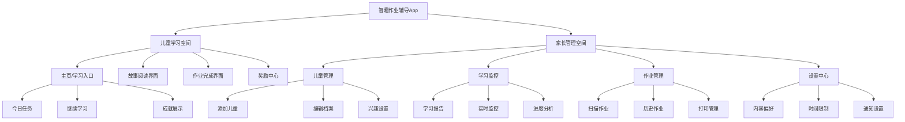
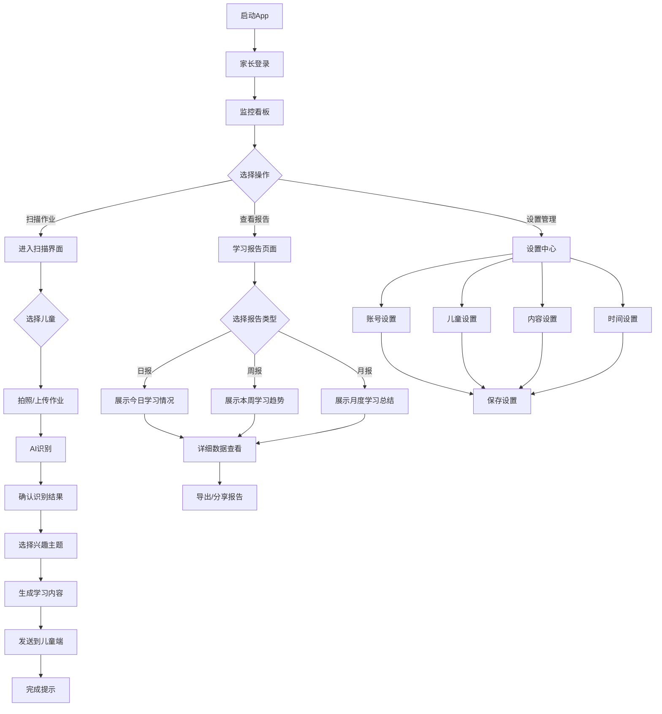
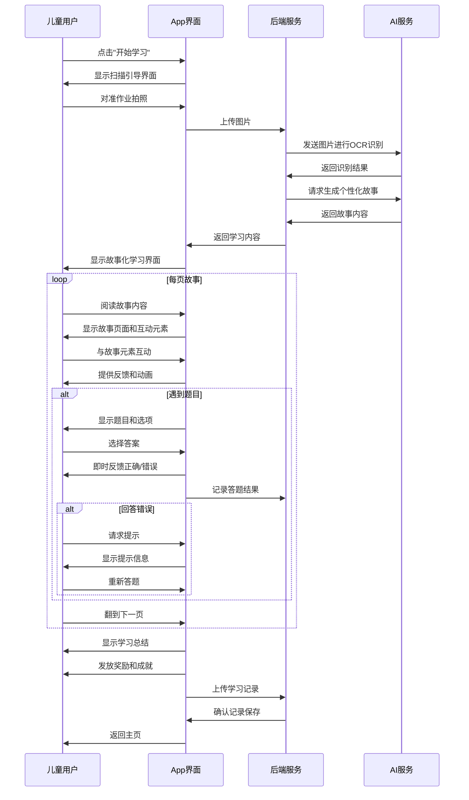
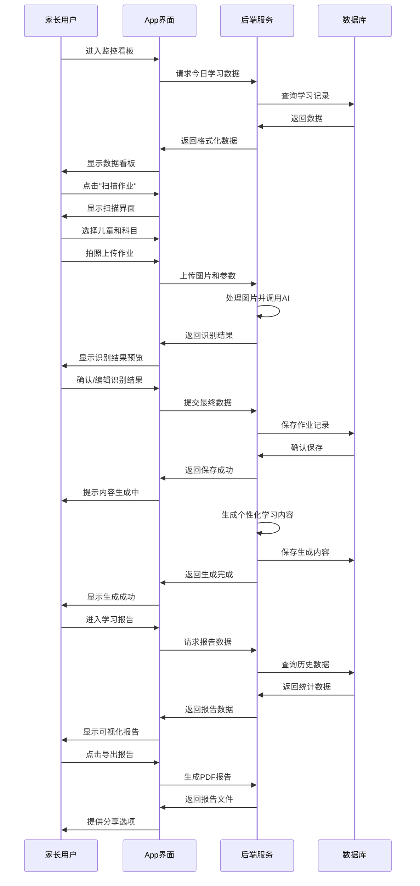

# AI赋能儿童作业辅导App - 用户体验设计原型文档

## 文档信息

| 文档版本 | 1.0 |
|---------|-----|
| 状态 | 评审中 |

## 1. 设计概述

### 1.1 设计目标
1. **对儿童**：
   - 创造沉浸式、游戏化的学习体验
   - 界面直观、操作简单，符合儿童认知特点
   - 通过视觉和动效反馈激发学习兴趣
   - 确保安全、健康的数字环境

2. **对家长**：
   - 操作流程简洁高效，减少学习成本
   - 信息展示清晰明了，快速了解孩子学习情况
   - 设置功能直观易懂，方便个性化配置
   - 多任务处理支持，兼顾工作和家庭需求

### 1.2 设计原则
| 原则 | 儿童端 | 家长端 |
|------|-------|-------|
| **简洁性** | 大按钮、少文字、直观图标 | 清晰导航、层级分明 |
| **一致性** | 统一的角色和视觉风格 | 统一的设计语言和交互模式 |
| **反馈性** | 即时、夸张的动画反馈 | 明确的操作结果提示 |
| **安全性** | 适龄内容、无外部链接 | 隐私保护、家长控制 |
| **趣味性** | 游戏化元素、故事化表达 | 数据可视化、成就展示 |
| **可访问性** | 大字体、高对比度、语音支持 | 清晰的文字、合适的字体大小 |

### 1.3 设计系统概览
```yaml
设计系统: SmartStudy Design System
版本: 1.0
颜色体系:
  主色调: #5A8DFF (科技蓝)
  辅助色: #FFB74D (活力橙), #4CD964 (成功绿)
  背景色: #F5F7FA (浅灰白)
  文字色: #333333 (深灰), #666666 (中灰)
字体系统:
  中文: PingFang SC (苹方), Hiragino Sans GB (冬青黑体)
  英文: SF Pro Display, SF Pro Text
  字号阶梯: 12, 14, 16, 18, 20, 24, 28, 32, 40, 48
圆角系统:
  小圆角: 4px (按钮、卡片)
  中圆角: 8px (容器、模态框)
  大圆角: 16px (头像、特色元素)
间距系统:
  基础单位: 8px
  间距阶梯: 4, 8, 12, 16, 24, 32, 48, 64, 96px
动效规范:
  过渡时长: 快速200ms, 中速300ms, 慢速400ms
  缓动函数: ease-in-out (平滑), spring (弹性)
  动效类型: 淡入淡出、滑动、缩放、旋转
```

## 2. 用户研究与角色画像

### 2.1 儿童用户画像

#### 2.1.1 认知特点分析
| 年龄 | 认知特点 | 设计对策 |
|------|---------|---------|
| 6-8岁 | 注意力集中时间短<br>依赖形象思维<br>喜欢鲜艳色彩和动画<br>操作能力有限 | 单任务界面<br>大量图片和动画<br>高饱和度色彩<br>大触控区域 |
| 9-10岁 | 有一定阅读能力<br>开始有逻辑思维<br>喜欢挑战和成就感<br>模仿能力强 | 简单文字说明<br>渐进式任务<br>奖励系统<br>角色榜样引导 |
| 11-12岁 | 自主学习能力增强<br>喜欢个性化表达<br>社交需求出现<br>有一定审美能力 | 个性化设置<br>成就分享<br>社交化元素<br>更成熟的设计风格 |

#### 2.1.2 操作习惯分析
```javascript
// 儿童操作习惯数据模型
const childInteractionPatterns = {
  touchPreference: {
    touchArea: "≥44px",  // 最小触控区域
    gestureComplexity: "simple",  // 简单手势
    swipeDirection: "horizontal"  // 水平滑动为主
  },
  attentionSpan: {
    averageDuration: "10-15分钟",  // 平均专注时长
    breakInterval: "每15-20分钟需要休息",
    engagementTriggers: ["动画", "声音反馈", "即时奖励"]
  },
  visualPreferences: {
    colorPalette: "鲜艳、对比度高",
    iconStyle: "拟物化、具象化",
    typography: "圆润、无衬线字体",
    animation: "夸张、有趣味性"
  },
  safetyRequirements: {
    noExternalLinks: true,  // 无外部链接
    contentFilter: true,  // 内容过滤
    timeLimits: true,  // 时间限制
    parentControl: true  // 家长控制
  }
};
```

### 2.2 家长用户画像

#### 2.2.1 使用场景分析
| 场景 | 时间 | 设备 | 核心需求 |
|------|------|------|---------|
| 作业准备 | 放学后<br>17:00-18:00 | 手机<br>平板 | 快速创建作业任务<br>简单扫描上传 |
| 学习陪伴 | 晚饭后<br>19:00-20:30 | 平板 | 查看学习进度<br>远程协助 |
| 学习回顾 | 周末<br>10:00-11:00 | 手机<br>电脑 | 查看学习报告<br>调整学习计划 |
| 设置管理 | 碎片时间 | 手机 | 修改儿童档案<br>调整学习参数 |

#### 2.2.2 痛点与需求
```javascript
// 家长用户痛点分析
const parentPainPoints = {
  timePressure: {
    description: "工作繁忙，辅导时间有限",
    designImplication: "简化操作流程，减少步骤"
  },
  expertiseLack: {
    description: "缺乏专业辅导知识",
    designImplication: "提供专业引导，降低门槛"
  },
  patienceExhaustion: {
    description: "辅导过程容易失去耐心",
    designImplication: "让学习过程自动化、趣味化"
  },
  progressTracking: {
    description: "难以量化学习效果",
    designImplication: "可视化数据报告，清晰展示进步"
  },
  safetyConcerns: {
    description: "担心电子产品对孩子的负面影响",
    designImplication: "内置时间管理，健康提醒"
  }
};
```

## 3. 信息架构

### 3.1 应用整体信息架构


### 3.2 儿童端信息架构

#### 3.2.1 导航结构
```
儿童学习空间
├── 学习主页 (Home)
│   ├── 今日任务卡片
│   ├── 继续上次学习
│   ├── 成就徽章展示
│   └── 快速入口
│       ├── 开始新学习
│       ├── 我的收藏
│       └── 奖励商店
├── 故事阅读 (Story)
│   ├── 故事封面
│   ├── 翻页阅读
│   ├── 互动元素
│   └── 答题界面
├── 作业完成 (Assignment)
│   ├── 题目展示区
│   ├── 答题操作区
│   ├── 提示帮助区
│   └── 进度指示器
├── 奖励中心 (Rewards)
│   ├── 我的积分
│   ├── 成就墙
│   ├── 兑换商店
│   └── 排行榜
└── 个人中心 (Profile)
    ├── 我的头像
    ├── 学习统计
    ├── 设置入口
    └── 退出登录
```

#### 3.2.2 页面层级深度
```yaml
页面深度规划:
  一级页面: 主页、故事阅读、作业完成、奖励中心、个人中心
  二级页面: 具体故事章节、专项练习、成就详情、积分兑换
  三级页面: 设置详情、帮助文档、关于我们
  
设计原则:
  1. 主要功能不超过2次点击可达
  2. 儿童常用功能在主页直接展示
  3. 减少页面跳转，多用模态框和抽屉
  4. 提供清晰的返回路径
```

### 3.3 家长端信息架构

#### 3.3.1 导航结构
```
家长管理空间
├── 监控看板 (Dashboard)
│   ├── 今日学习概览
│   ├── 儿童学习状态
│   ├── 近期作业完成情况
│   └── 快速操作入口
├── 儿童管理 (Children)
│   ├── 儿童列表
│   ├── 添加儿童
│   ├── 档案详情
│   └── 兴趣设置
├── 作业管理 (Assignments)
│   ├── 扫描作业
│   ├── 作业列表
│   ├── 作业详情
│   └── 打印管理
├── 学习报告 (Reports)
│   ├── 日报
│   ├── 周报
│   ├── 月报
│   └── 专项分析
└── 设置中心 (Settings)
    ├── 账号设置
    ├── 内容偏好
    ├── 时间管理
    ├── 通知设置
    └── 帮助与反馈
```

#### 3.3.2 信息组织原则
```yaml
信息密度: 适中密度，避免信息过载
视觉层次: 使用大小、颜色、间距建立清晰的视觉层次
导航模式: 底部标签导航 + 顶部操作栏
内容分组: 按功能模块分组，每屏一个主要任务
操作优先级: 高频操作前置，低频操作后置或隐藏
```

## 4. 交互设计

### 4.1 核心用户流程

#### 4.1.1 儿童学习完整流程
```mermaid
graph TD
    A[启动App] --> B{选择儿童}
    B --> C[儿童主页]
    C --> D[点击"开始学习"]
    D --> E[扫描作业页面]
    E --> F{选择扫描方式}
    F -->|拍照| G[打开相机]
    F -->|相册| H[选择照片]
    G --> I[拍摄作业]
    H --> I
    I --> J[AI识别处理]
    J --> K[生成个性化故事]
    K --> L[故事阅读界面]
    L --> M[翻页阅读]
    M --> N{遇到题目}
    N -->|是| O[进入答题界面]
    N -->|否| P[继续阅读]
    O --> Q[答题操作]
    Q --> R{答案正确?}
    R -->|是| S[正向反馈]
    R -->|否| T[提示帮助]
    S --> U[继续下一题]
    T --> Q
    U --> V{所有题目完成?}
    V -->|否| O
    V -->|是| W[学习完成总结]
    W --> X[获得奖励]
    X --> Y[返回主页]
```

#### 4.1.2 家长管理核心流程


### 4.2 交互细节设计

#### 4.2.1 儿童端交互细节

**1. 主页交互设计**
```javascript
// 主页交互状态机
const homePageInteraction = {
  states: {
    idle: {
      entry: "显示静态内容",
      on: {
        tapTaskCard: "taskSelected",
        tapContinue: "resumeLearning",
        tapReward: "showRewards",
        swipeLeft: "showNextCard",
        swipeRight: "showPreviousCard"
      }
    },
    taskSelected: {
      entry: "高亮选中任务",
      on: {
        tapStart: "startLearning",
        tapBack: "idle"
      }
    },
    startLearning: {
      entry: "播放开始动画",
      on: {
        animationComplete: "navigateToStory"
      }
    }
  },
  
  animations: {
    cardSwipe: {
      type: "spring",
      stiffness: 300,
      damping: 30,
      duration: 300
    },
    buttonTap: {
      type: "scale",
      from: 1,
      to: 0.95,
      duration: 150
    },
    taskHighlight: {
      type: "pulse",
      scale: [1, 1.05, 1],
      duration: 500
    }
  },
  
  feedback: {
    tap: "轻微震动 + 缩放效果",
    success: "彩色粒子动画 + 正向音效",
    error: "轻微震动 + 错误提示音",
    progress: "进度条动画 + 鼓励话语"
  }
};
```

**2. 故事阅读交互**
```javascript
// 故事阅读手势交互
const storyReadingGestures = {
  pageTurn: {
    direction: "horizontal",
    threshold: 50, // 像素
    velocity: 0.3, // 最小速度
    action: {
      leftSwipe: "nextPage",
      rightSwipe: "previousPage"
    },
    feedback: {
      visual: "页面卷曲效果",
      sound: "翻书声",
      haptic: "轻微震动"
    }
  },
  
  tapInteraction: {
    hotSpots: [
      {
        area: "character", // 角色区域
        action: "characterSpeak",
        feedback: "角色说话动画 + 音效"
      },
      {
        area: "interactiveElement", // 可交互元素
        action: "triggerAnimation",
        feedback: "元素动画 + 互动音效"
      },
      {
        area: "question", // 问题区域
        action: "showHint",
        feedback: "高亮 + 提示音"
      }
    ],
    
    longPress: {
      duration: 1000, // 毫秒
      action: "showOptions",
      options: ["朗读", "解释", "收藏"]
    }
  },
  
  voiceControl: {
    commands: [
      {
        phrase: "下一页",
        action: "nextPage",
        feedback: "语音确认"
      },
      {
        phrase: "上一页",
        action: "previousPage",
        feedback: "语音确认"
      },
      {
        phrase: "朗读",
        action: "toggleNarration",
        feedback: "开始/停止朗读"
      }
    ]
  }
};
```

**3. 答题交互设计**
```javascript
// 答题交互状态
const questionInteraction = {
  questionTypes: {
    multipleChoice: {
      interaction: "tapSelection",
      selectionStyle: "bubble",
      feedback: {
        correct: {
          animation: "bubblePop + 彩色星星",
          sound: "correct_sound.mp3",
          message: ["太棒了！", "完全正确！", "你真聪明！"]
        },
        incorrect: {
          animation: "shake + 灰色效果",
          sound: "incorrect_sound.mp3",
          message: ["再试试看", "差一点就对了", "看看提示吧"]
        }
      }
    },
    
    fillBlank: {
      interaction: "keyboardInput",
      keyboardType: "根据题目类型变化",
      validation: "实时验证 + 自动补全",
      feedback: {
        correct: "输入框变绿 + 对号动画",
        incorrect: "输入框变红 + 叉号动画"
      }
    },
    
    dragDrop: {
      interaction: "dragAndDrop",
      dragElements: "可拖动的答案选项",
      dropZones: "答题区域",
      snapToGrid: true,
      feedback: "吸附效果 + 放置音效"
    }
  },
  
  hintSystem: {
    levels: [
      {
        level: 1,
        trigger: "第一次错误",
        content: "文字提示",
        cost: 0
      },
      {
        level: 2,
        trigger: "第二次错误",
        content: "图像提示",
        cost: 0
      },
      {
        level: 3,
        trigger: "第三次错误",
        content: "分步引导",
        cost: 0
      },
      {
        level: 4,
        trigger: "手动请求",
        content: "视频讲解",
        cost: "积分消耗"
      }
    ],
    
    animation: {
      hintAppear: "从底部滑入",
      hintHighlight: "脉动效果",
      hintDisappear: "淡出效果"
    }
  }
};
```

#### 4.2.2 家长端交互细节

**1. 作业扫描交互**
```javascript
// 扫描流程交互
const scanWorkflow = {
  steps: [
    {
      step: 1,
      name: "选择儿童",
      ui: "儿童头像网格",
      interaction: "tapSelection",
      validation: "必须选择一个儿童"
    },
    {
      step: 2,
      name: "选择科目",
      ui: "科目卡片",
      interaction: "tapSelection",
      validation: "必须选择一个科目"
    },
    {
      step: 3,
      name: "拍摄作业",
      ui: "相机界面",
      interaction: [
        "tapToCapture",
        "dragToAdjust",
        "pinchToZoom"
      ],
      guidance: "自动边缘检测 + 对焦辅助"
    },
    {
      step: 4,
      name: "AI识别",
      ui: "加载动画 + 进度指示",
      duration: "3-5秒",
      feedback: "实时进度显示 + 预估时间"
    },
    {
      step: 5,
      name: "确认结果",
      ui: "识别结果预览 + 编辑工具",
      interaction: [
        "tapToEditText",
        "dragToReorder",
        "swipeToDelete"
      ],
      autoAction: "5秒后自动进入下一步"
    },
    {
      step: 6,
      name: "选择兴趣主题",
      ui: "兴趣标签云",
      interaction: "tapSelection",
      multiple: true,
      maxSelection: 3
    },
    {
      step: 7,
      name: "生成内容",
      ui: "生成动画 + 进度条",
      duration: "5-10秒",
      feedback: "倒计时 + 趣味提示语"
    }
  ],
  
  progressIndicator: {
    type: "stepProgressBar",
    showStepNumbers: true,
    showStepNames: true,
    canSkip: false,
    canGoBack: true
  }
};
```

**2. 学习报告交互**
```javascript
// 学习报告数据可视化
const reportVisualization = {
  timeRangeSelector: {
    types: ["今日", "本周", "本月", "自定义"],
    default: "本周",
    interaction: "segmentedControl"
  },
  
  metricsDashboard: {
    layout: "grid",
    widgets: [
      {
        type: "学习时长",
        visualization: "环形进度图",
        interaction: "tapToViewDetails",
        comparison: "与上周对比"
      },
      {
        type: "完成题目",
        visualization: "柱状图",
        interaction: "tapToFilterBySubject",
        breakdown: "按科目细分"
      },
      {
        type: "正确率",
        visualization: "折线图",
        interaction: "pinchToZoomTimeline",
        trend: "显示趋势箭头"
      },
      {
        type: "专注度",
        visualization: "热力图",
        interaction: "tapToSeeDetails",
        timeSlots: "按时间段显示"
      }
    ]
  },
  
  subjectBreakdown: {
    visualization: "雷达图",
    dimensions: ["数学", "语文", "英语", "科学"],
    interaction: {
      tapSegment: "高亮该科目",
      doubleTap: "查看科目详情",
      longPress: "对比多个时间段"
    }
  },
  
  exportOptions: {
    formats: ["PDF", "图片", "Excel"],
    sharing: ["微信", "钉钉", "邮件", "保存到相册"],
    customization: {
      includeCharts: true,
      includeDetails: true,
      dateRange: "可自定义"
    }
  }
};
```

### 4.3 动效设计规范

#### 4.3.1 儿童端动效
```javascript
// 儿童端动效库
const childAnimations = {
  entrance: {
    pageEnter: {
      type: "slideFromRight",
      duration: 400,
      easing: "cubic-bezier(0.34, 1.56, 0.64, 1)"
    },
    elementAppear: {
      type: "fadeInUp",
      duration: 300,
      easing: "easeOutBack",
      stagger: 100
    }
  },
  
  interaction: {
    buttonTap: {
      type: "scale",
      scale: 0.95,
      duration: 150,
      easing: "easeInOut"
    },
    cardSelect: {
      type: "spring",
      properties: {
        scale: 1.05,
        rotation: 2,
        shadow: "0 8px 25px rgba(0,0,0,0.1)"
      },
      duration: 300
    },
    correctAnswer: {
      type: "particleExplosion",
      particles: 15,
      colors: ["#4CD964", "#5AC8FA", "#FFCC00"],
      duration: 800
    }
  },
  
  feedback: {
    success: {
      visual: "confettiRain",
      sound: "success_fanfare.mp3",
      haptic: "medium"
    },
    progress: {
      visual: "progressFill",
      sound: "progress_ring.mp3",
      duration: "根据进度变化"
    },
    celebration: {
      visual: "characterDance",
      sound: "celebration_music.mp3",
      duration: 2000
    }
  },
  
  learning: {
    pageTurn: {
      type: "pageCurl",
      direction: "horizontal",
      duration: 500,
      sound: "page_turn.mp3"
    },
    hintReveal: {
      type: "typewriter",
      speed: 50, // 字符/秒
      sound: "typing.mp3"
    },
    puzzleComplete: {
      type: "puzzleSnap",
      pieces: 4,
      duration: 600,
      sound: "snap_into_place.mp3"
    }
  }
};
```

#### 4.3.2 家长端动效
```javascript
// 家长端动效库
const parentAnimations = {
  navigation: {
    tabSwitch: {
      type: "fadeCross",
      duration: 300,
      easing: "easeInOutCubic"
    },
    modalOpen: {
      type: "scaleIn",
      scale: 0.9,
      duration: 250,
      backdrop: "dim"
    },
    drawerOpen: {
      type: "slideFromLeft",
      duration: 300,
      easing: "cubic-bezier(0.25, 0.46, 0.45, 0.94)"
    }
  },
  
  data: {
    chartLoad: {
      type: "growFromZero",
      duration: 600,
      easing: "easeOutBack"
    },
    numberCount: {
      type: "countUp",
      duration: 1000,
      easing: "easeOutQuad"
    },
    progressFill: {
      type: "widthGrow",
      duration: 500,
      easing: "easeOutCirc"
    }
  },
  
  feedback: {
    success: {
      type: "checkmarkDraw",
      duration: 400,
      color: "#4CD964"
    },
    error: {
      type: "shake",
      intensity: 10,
      duration: 500
    },
    loading: {
      type: "pulse",
      duration: 1000,
      repeat: "infinite"
    }
  },
  
  transitions: {
    listReorder: {
      type: "flip",
      duration: 400,
      easing: "easeInOutBack"
    },
    photoUpload: {
      type: "scaleAndFade",
      duration: 300
    },
    scanProcessing: {
      type: "pulseRing",
      duration: 800,
      repeat: "infinite"
    }
  }
};
```

## 5. 视觉设计

### 5.1 设计语言系统

#### 5.1.1 色彩系统
```css
/* 主色板 */
:root {
  /* 品牌色 */
  --color-primary: #5A8DFF;
  --color-primary-light: #8CB1FF;
  --color-primary-dark: #3A6BFF;
  
  /* 辅助色 */
  --color-secondary: #FFB74D;
  --color-success: #4CD964;
  --color-warning: #FF9500;
  --color-error: #FF3B30;
  --color-info: #5AC8FA;
  
  /* 中性色 */
  --color-text-primary: #333333;
  --color-text-secondary: #666666;
  --color-text-tertiary: #999999;
  --color-border: #E0E0E0;
  --color-background: #F5F7FA;
  --color-surface: #FFFFFF;
  
  /* 儿童主题色 */
  --color-child-theme-1: #FF6B6B; /* 活力红 */
  --color-child-theme-2: #4ECDC4; /* 清新青 */
  --color-child-theme-3: #FFD166; /* 明亮黄 */
  --color-child-theme-4: #06D6A0; /* 生机绿 */
  --color-child-theme-5: #118AB2; /* 海洋蓝 */
}

/* 色彩应用规范 */
.color-application {
  /* 儿童界面 */
  .child-ui {
    primary-color: var(--color-child-theme-1);
    secondary-color: var(--color-child-theme-2);
    accent-color: var(--color-child-theme-3);
    background-color: #FFF9F0; /* 柔和的米白色 */
  }
  
  /* 家长界面 */
  .parent-ui {
    primary-color: var(--color-primary);
    secondary-color: var(--color-secondary);
    accent-color: var(--color-success);
    background-color: var(--color-background);
  }
  
  /* 状态色 */
  .status {
    success: var(--color-success);
    warning: var(--color-warning);
    error: var(--color-error);
    info: var(--color-info);
  }
}
```

#### 5.1.2 字体系统
```css
/* 字体定义 */
:root {
  /* 儿童字体 */
  --font-child-display: "Comic Sans MS", "幼圆", sans-serif;
  --font-child-body: "PingFang SC", "Hiragino Sans GB", "Microsoft YaHei", sans-serif;
  
  /* 家长字体 */
  --font-parent-display: "SF Pro Display", "PingFang SC", sans-serif;
  --font-parent-body: "SF Pro Text", "PingFang SC", sans-serif;
  
  /* 字号规范 - 儿童端 */
  --font-size-child-xxl: 32px; /* 大标题 */
  --font-size-child-xl: 28px;  /* 标题 */
  --font-size-child-lg: 24px;  /* 副标题 */
  --font-size-child-md: 20px;  /* 正文 */
  --font-size-child-sm: 18px;  /* 说明文字 */
  --font-size-child-xs: 16px;  /* 辅助信息 */
  
  /* 字号规范 - 家长端 */
  --font-size-parent-xxl: 24px;
  --font-size-parent-xl: 20px;
  --font-size-parent-lg: 18px;
  --font-size-parent-md: 16px;
  --font-size-parent-sm: 14px;
  --font-size-parent-xs: 12px;
  
  /* 行高 */
  --line-height-tight: 1.2;
  --line-height-normal: 1.5;
  --line-height-loose: 1.8;
}

/* 字体应用 */
.font-application {
  /* 儿童界面字体 */
  .child-ui {
    display-font: var(--font-child-display);
    body-font: var(--font-child-body);
    font-weight: 400; /* 常规体 */
    
    .title {
      font-size: var(--font-size-child-xxl);
      line-height: var(--line-height-tight);
      font-weight: 700;
    }
    
    .body {
      font-size: var(--font-size-child-md);
      line-height: var(--line-height-normal);
    }
  }
  
  /* 家长界面字体 */
  .parent-ui {
    display-font: var(--font-parent-display);
    body-font: var(--font-parent-body);
    
    .title {
      font-size: var(--font-size-parent-xl);
      line-height: var(--line-height-tight);
      font-weight: 600;
    }
    
    .body {
      font-size: var(--font-size-parent-md);
      line-height: var(--line-height-normal);
    }
  }
}
```

#### 5.1.3 图标系统
```css
/* 图标尺寸规范 */
.icon-sizing {
  /* 儿童界面图标 */
  .child-icon {
    extra-small: 16px;
    small: 24px;
    medium: 32px;
    large: 48px;
    extra-large: 64px;
  }
  
  /* 家长界面图标 */
  .parent-icon {
    extra-small: 12px;
    small: 16px;
    medium: 24px;
    large: 32px;
    extra-large: 48px;
  }
}

/* 图标样式 */
.icon-style {
  /* 填充图标 */
  .filled {
    fill: currentColor;
    stroke: none;
  }
  
  /* 描边图标 */
  .outlined {
    fill: none;
    stroke: currentColor;
    stroke-width: 2;
  }
  
  /* 双色图标 */
  .two-tone {
    primary-color: var(--color-primary);
    secondary-color: var(--color-secondary);
  }
}

/* 动效图标 */
.animated-icons {
  .loading {
    animation: spin 1s linear infinite;
  }
  
  .success {
    animation: checkmark-draw 0.5s ease-out;
  }
  
  .error {
    animation: shake 0.5s ease-out;
  }
}

@keyframes spin {
  from { transform: rotate(0deg); }
  to { transform: rotate(360deg); }
}

@keyframes checkmark-draw {
  0% { stroke-dashoffset: 100; }
  100% { stroke-dashoffset: 0; }
}

@keyframes shake {
  0%, 100% { transform: translateX(0); }
  25% { transform: translateX(-5px); }
  75% { transform: translateX(5px); }
}
```

### 5.2 界面设计规范

#### 5.2.1 儿童端界面组件库

**1. 按钮组件**
```css
/* 儿童按钮样式 */
.child-button {
  /* 尺寸 */
  &.size-small {
    padding: 12px 24px;
    font-size: 18px;
    min-height: 44px;
  }
  
  &.size-medium {
    padding: 16px 32px;
    font-size: 20px;
    min-height: 52px;
  }
  
  &.size-large {
    padding: 20px 40px;
    font-size: 24px;
    min-height: 60px;
  }
  
  /* 变体 */
  &.variant-primary {
    background: linear-gradient(135deg, #FF6B6B, #FF8E53);
    color: white;
    border-radius: 25px;
    box-shadow: 0 4px 12px rgba(255, 107, 107, 0.3);
    
    &:active {
      transform: scale(0.95);
      box-shadow: 0 2px 6px rgba(255, 107, 107, 0.3);
    }
  }
  
  &.variant-secondary {
    background: white;
    color: #FF6B6B;
    border: 2px solid #FF6B6B;
    border-radius: 25px;
    
    &:active {
      background: #FFF5F5;
    }
  }
  
  &.variant-ghost {
    background: transparent;
    color: #FF6B6B;
    
    &:active {
      background: rgba(255, 107, 107, 0.1);
    }
  }
  
  /* 状态 */
  &:disabled {
    opacity: 0.5;
    cursor: not-allowed;
  }
  
  &.loading {
    position: relative;
    color: transparent;
    
    &::after {
      content: '';
      position: absolute;
      width: 20px;
      height: 20px;
      border: 2px solid white;
      border-radius: 50%;
      border-top-color: transparent;
      animation: spin 1s linear infinite;
    }
  }
}
```

**2. 卡片组件**
```css
/* 儿童卡片组件 */
.child-card {
  background: white;
  border-radius: 20px;
  overflow: hidden;
  box-shadow: 0 8px 24px rgba(0, 0, 0, 0.1);
  
  /* 交互状态 */
  transition: all 0.3s ease;
  
  &:active {
    transform: translateY(4px);
    box-shadow: 0 4px 12px rgba(0, 0, 0, 0.1);
  }
  
  /* 卡片类型 */
  &.type-task {
    border-left: 8px solid #4ECDC4;
  }
  
  &.type-reward {
    border-left: 8px solid #FFD166;
  }
  
  &.type-story {
    border-left: 8px solid #118AB2;
  }
  
  /* 卡片内容 */
  .card-header {
    padding: 20px 20px 0;
    
    .card-title {
      font-size: 20px;
      font-weight: bold;
      color: #333;
      margin-bottom: 8px;
    }
    
    .card-subtitle {
      font-size: 16px;
      color: #666;
    }
  }
  
  .card-body {
    padding: 16px 20px;
  }
  
  .card-footer {
    padding: 0 20px 20px;
    display: flex;
    justify-content: space-between;
    align-items: center;
  }
}
```

**3. 进度指示器**
```css
/* 儿童进度组件 */
.child-progress {
  /* 线性进度条 */
  &.type-linear {
    width: 100%;
    height: 20px;
    background: #E0E0E0;
    border-radius: 10px;
    overflow: hidden;
    
    .progress-bar {
      height: 100%;
      background: linear-gradient(90deg, #4ECDC4, #06D6A0);
      border-radius: 10px;
      transition: width 0.5s ease-out;
      position: relative;
      
      &::after {
        content: '';
        position: absolute;
        top: 0;
        left: 0;
        right: 0;
        bottom: 0;
        background: linear-gradient(
          90deg,
          transparent 0%,
          rgba(255, 255, 255, 0.3) 50%,
          transparent 100%
        );
        animation: shimmer 2s infinite;
      }
    }
  }
  
  /* 环形进度条 */
  &.type-circular {
    width: 80px;
    height: 80px;
    position: relative;
    
    .progress-circle {
      width: 100%;
      height: 100%;
      
      circle {
        fill: none;
        stroke-width: 8;
        stroke-linecap: round;
        transform: rotate(-90deg);
        transform-origin: 50% 50%;
        
        &.background {
          stroke: #E0E0E0;
        }
        
        &.foreground {
          stroke: #FF6B6B;
          stroke-dasharray: 251.2; /* 2 * π * 40 */
          stroke-dashoffset: calc(251.2 * (1 - var(--progress)));
          transition: stroke-dashoffset 0.5s ease-out;
        }
      }
    }
    
    .progress-text {
      position: absolute;
      top: 50%;
      left: 50%;
      transform: translate(-50%, -50%);
      font-size: 20px;
      font-weight: bold;
      color: #333;
    }
  }
}

@keyframes shimmer {
  0% { transform: translateX(-100%); }
  100% { transform: translateX(100%); }
}
```

#### 5.2.2 家长端界面组件库

**1. 数据卡片**
```css
/* 家长数据卡片 */
.parent-data-card {
  background: white;
  border-radius: 12px;
  padding: 20px;
  box-shadow: 0 2px 8px rgba(0, 0, 0, 0.08);
  
  /* 卡片类型 */
  &.type-summary {
    border-top: 4px solid var(--color-primary);
  }
  
  &.type-trend {
    border-top: 4px solid var(--color-success);
  }
  
  &.type-alert {
    border-top: 4px solid var(--color-warning);
  }
  
  /* 卡片头部 */
  .card-header {
    display: flex;
    justify-content: space-between;
    align-items: center;
    margin-bottom: 16px;
    
    .title {
      font-size: 16px;
      font-weight: 600;
      color: var(--color-text-secondary);
    }
    
    .action {
      color: var(--color-primary);
      font-size: 14px;
      cursor: pointer;
      
      &:hover {
        opacity: 0.8;
      }
    }
  }
  
  /* 卡片内容 */
  .card-content {
    .main-value {
      font-size: 32px;
      font-weight: 700;
      color: var(--color-text-primary);
      margin-bottom: 8px;
    }
    
    .comparison {
      display: flex;
      align-items: center;
      gap: 8px;
      font-size: 14px;
      color: var(--color-text-tertiary);
      
      &.positive {
        color: var(--color-success);
      }
      
      &.negative {
        color: var(--color-error);
      }
    }
    
    .chart-container {
      margin-top: 16px;
      height: 60px;
    }
  }
}
```

**2. 表单组件**
```css
/* 家长表单组件 */
.parent-form {
  /* 输入框 */
  .form-input {
    width: 100%;
    padding: 12px 16px;
    border: 1px solid var(--color-border);
    border-radius: 8px;
    font-size: 16px;
    color: var(--color-text-primary);
    background: white;
    transition: all 0.2s;
    
    &:focus {
      outline: none;
      border-color: var(--color-primary);
      box-shadow: 0 0 0 3px rgba(90, 141, 255, 0.1);
    }
    
    &.error {
      border-color: var(--color-error);
      
      &:focus {
        box-shadow: 0 0 0 3px rgba(255, 59, 48, 0.1);
      }
    }
    
    &:disabled {
      background: var(--color-background);
      color: var(--color-text-tertiary);
      cursor: not-allowed;
    }
  }
  
  /* 标签 */
  .form-label {
    display: block;
    margin-bottom: 8px;
    font-size: 14px;
    font-weight: 500;
    color: var(--color-text-secondary);
    
    &.required::after {
      content: '*';
      color: var(--color-error);
      margin-left: 4px;
    }
  }
  
  /* 错误提示 */
  .form-error {
    margin-top: 4px;
    font-size: 12px;
    color: var(--color-error);
  }
  
  /* 选择器 */
  .form-select {
    width: 100%;
    padding: 12px 16px;
    border: 1px solid var(--color-border);
    border-radius: 8px;
    font-size: 16px;
    color: var(--color-text-primary);
    background: white;
    appearance: none;
    background-image: url("data:image/svg+xml,...");
    background-repeat: no-repeat;
    background-position: right 16px center;
    background-size: 16px;
  }
  
  /* 复选框和单选框 */
  .form-checkbox,
  .form-radio {
    display: flex;
    align-items: center;
    gap: 8px;
    cursor: pointer;
    
    input {
      width: 20px;
      height: 20px;
    }
    
    label {
      font-size: 16px;
      color: var(--color-text-primary);
    }
  }
}
```

**3. 表格组件**
```css
/* 家长表格组件 */
.parent-table {
  width: 100%;
  border-collapse: collapse;
  
  /* 表头 */
  thead {
    background: var(--color-background);
    
    th {
      padding: 16px;
      text-align: left;
      font-size: 14px;
      font-weight: 600;
      color: var(--color-text-secondary);
      border-bottom: 1px solid var(--color-border);
      
      &.sortable {
        cursor: pointer;
        
        &:hover {
          background: rgba(0, 0, 0, 0.02);
        }
        
        &.sorted {
          color: var(--color-primary);
          
          &::after {
            content: '↕';
            margin-left: 4px;
            font-size: 12px;
          }
          
          &.asc::after {
            content: '↑';
          }
          
          &.desc::after {
            content: '↓';
          }
        }
      }
    }
  }
  
  /* 表格内容 */
  tbody {
    tr {
      border-bottom: 1px solid var(--color-border);
      transition: background 0.2s;
      
      &:hover {
        background: rgba(0, 0, 0, 0.02);
      }
      
      &:last-child {
        border-bottom: none;
      }
      
      td {
        padding: 16px;
        font-size: 14px;
        color: var(--color-text-primary);
        
        &.action-cell {
          text-align: right;
          
          .action-button {
            padding: 6px 12px;
            font-size: 12px;
            margin-left: 8px;
          }
        }
      }
    }
  }
  
  /* 空状态 */
  .empty-state {
    padding: 48px 0;
    text-align: center;
    color: var(--color-text-tertiary);
    
    .empty-icon {
      font-size: 48px;
      margin-bottom: 16px;
      opacity: 0.3;
    }
    
    .empty-text {
      font-size: 16px;
    }
  }
}
```

### 5.3 页面原型设计

#### 5.3.1 儿童学习主页
```
+--------------------------------------------------+
| 🏠 儿童学习主页                                 |
+--------------------------------------------------+
|                                                  |
|  [儿童头像] 小明                                |
|  欢迎回来！今天也要加油哦！✨                   |
|                                                  |
|  +------------------------+                      |
|  |     今日任务           |                      |
|  |                        |                      |
|  |  📚 数学作业           |                      |
|  |  10道题目 · 预计20分钟 |                      |
|  |  🔥 奥特曼主题         |                      |
|  |                        |                      |
|  |  [开始学习]按钮        |                      |
|  +------------------------+                      |
|                                                  |
|  +------------------------+                      |
|  |     继续学习           |                      |
|  |                        |                      |
|  |  🚀 太空冒险 - 第3章   |                      |
|  |  进度：■■■■□□ 60%      |                      |
|  |                        |                      |
|  |  [继续]按钮            |                      |
|  +------------------------+                      |
|                                                  |
|  +------------------------+                      |
|  |     我的成就           |                      |
|  |                        |                      |
|  |  🏆 数学小能手         |                      |
|  |  ⭐ 连续学习5天         |                     |
|  |  🎯 快速解题王         |                      |
|  |                        |                      |
|  |  [查看全部]按钮        |                      |
|  +------------------------+                      |
|                                                  |
|  [底部导航栏]                                   |
|  主页  故事  奖励  我的                          |
+--------------------------------------------------+
```

**交互说明：**
1. **顶部区域**：显示儿童头像和欢迎语，点击头像可进入个人中心
2. **今日任务卡片**：显示当天需要完成的主要任务，点击"开始学习"进入学习流程
3. **继续学习卡片**：显示上次未完成的学习内容，支持断点续学
4. **成就展示区**：展示最近获得的成就，激励儿童继续学习
5. **底部导航**：固定导航栏，包含四个主要功能入口
6. **视觉设计**：使用明亮色彩、圆角卡片、可爱的图标元素

#### 5.3.2 故事阅读界面
```
+--------------------------------------------------+
| 📖 奥特曼的数学冒险 - 第3页/共8页              |
+--------------------------------------------------+
|                                                  |
|  [全屏漫画插图]                                |
|  ╔══════════════════════════════════════╗      |
|  ║                                      ║      |
|  ║    🦸♂️ 赛罗奥特曼站在火星上         ║      |
|  ║    "我需要收集能量块来打败怪兽！"    ║      |
|  ║                                      ║      |
|  ║    📦 这里发现了5个能量块            ║      |
|  ║    📦 那里又发现了3个能量块          ║      |
|  ║                                      ║      |
|  ║    问题：一共有多少个能量块？         ║      |
|  ╚══════════════════════════════════════╝      |
|                                                  |
|  [互动元素]                                     |
|  点击奥特曼：播放语音"加油！"                   |
|  点击能量块：显示数字动画                       |
|                                                  |
|  [答题区域]                                     |
|  A. 6个    B. 7个    C. 8个    D. 9个          |
|                                                  |
|  [底部工具栏]                                   |
|  ◀️上一页  🔊朗读  ❓提示  ▶️下一页             |
+--------------------------------------------------+
```

**交互说明：**
1. **漫画区域**：占据屏幕主要区域，展示故事漫画
2. **互动元素**：可点击的角色和物品，提供额外反馈
3. **答题区域**：故事中融入的问题，以选择题形式出现
4. **底部工具栏**：提供翻页、朗读、提示等功能
5. **视觉设计**：全屏漫画风格，角色形象生动，色彩鲜明

#### 5.3.3 家长监控看板
```
+--------------------------------------------------+
| 📊 学习监控看板                     [刷新] 🔄  |
+--------------------------------------------------+
|                                                  |
|  [儿童切换] 小明 ▼ | 今天 · 本周 · 本月       |
|                                                  |
|  +----------------+ +----------------+          |
|  |   今日学习时长 | |   完成作业数   |          |
|  |                | |                |          |
|  |     45分钟     | |      3份       |          |
|  |   ↑ 15% 昨天   | |   ↑ 1份 昨天   |          |
|  +----------------+ +----------------+          |
|                                                  |
|  +----------------+ +----------------+          |
|  |   平均正确率   | |   专注度评分   |          |
|  |                | |                |          |
|  |     85%        | |      ⭐⭐⭐⭐☆    |
|  |   → 持平 上周   | |   ↑ 0.5分 昨天  |        |
|  +----------------+ +----------------+          |
|                                                  |
|  [学习趋势图]                                   |
|   ┌────────────────────────────────────┐        |
|   │                                    │        |
|   │       数学  ───                    │        |
|   │       语文  ─ ─                    │        |
|   │       英语  ─··                    │        |
|   └────────────────────────────────────┘        |
|   一  二  三  四  五  六  日                   |
|                                                  |
|  [最近活动]                                     |
|  · 10:30 完成数学作业 (95分)                    |
|  · 14:15 开始语文练习                           |
|  · 16:45 获得"快速解题王"成就                   |
|                                                  |
|  [快速操作]                                     |
|  [扫描作业] [布置任务] [查看报告]               |
+--------------------------------------------------+
```

**交互说明：**
1. **数据概览**：四个关键指标卡片，显示变化趋势
2. **趋势图表**：可视化展示学习数据变化
3. **最近活动**：时间线形式展示最新学习活动
4. **快速操作**：常用功能的快捷入口
5. **视觉设计**：数据可视化清晰，操作入口明确

#### 5.3.4 作业扫描界面
```
+--------------------------------------------------+
| 📷 扫描作业                         [帮助] ❓  |
+--------------------------------------------------+
|                                                  |
|  选择儿童：👦 小明  👧 小红  [添加+]           |
|                                                  |
|  选择科目：📐 数学  📖 语文  🔤 英语          |
|                                                  |
|  [相机预览区域]                                 |
|  ╔══════════════════════════════════════╗      |
|  ║                                      ║      |
|  ║       对准作业，保持平稳             ║      |
|  ║                                      ║      |
|  ║        ┌─────────────────┐          ║      |
|  ║        │                 │          ║      |
|  ║        │   取景框        │          ║      |
|  ║        │                 │          ║      |
|  ║        └─────────────────┘          ║      |
|  ║                                      ║      |
|  ║    自动检测边缘中...                ║      |
|  ╚══════════════════════════════════════╝      |
|                                                  |
|  [底部操作栏]                                   |
|  📁 相册   ⚪ 拍照   ✏️ 手动输入                |
|                                                  |
|  [拍摄提示]                                     |
|  · 确保光线充足                                 |
|  · 对准作业四边                                 |
|  · 保持手机平稳                                 |
+--------------------------------------------------+
```

**交互说明：**
1. **选择区域**：先选择儿童和科目
2. **相机预览**：实时显示相机画面，有取景框引导
3. **自动检测**：自动检测作业边缘，提供视觉反馈
4. **操作选项**：拍照、相册、手动输入三种方式
5. **拍摄提示**：提供拍摄指导，提高识别成功率

## 6. 原型交互流程

### 6.1 儿童学习完整流程原型



### 6.2 家长管理核心流程原型



## 7. 可用性测试计划

### 7.1 测试目标
1. 验证儿童用户的学习流程是否直观易用
2. 评估家长用户的管理功能是否高效便捷
3. 测试核心交互的完成率和错误率
4. 收集用户反馈，优化用户体验

### 7.2 测试方法
```yaml
测试方法:
  1. 可用性测试 (Usability Testing)
    - 参与者: 10名儿童 + 10名家长
    - 任务: 完成核心使用场景
    - 指标: 任务完成率、时间、错误次数
  
  2. A/B测试 (A/B Testing)
    - 变量: 界面布局、颜色方案、交互方式
    - 指标: 点击率、转化率、停留时间
  
  3. 眼动追踪 (Eye Tracking)
    - 设备: Tobii眼动仪
    - 指标: 视觉热点图、注视路径、首次注视时间
  
  4. 用户访谈 (User Interview)
    - 形式: 半结构化访谈
    - 时长: 30-45分钟/人
    - 重点: 使用感受、痛点、改进建议
```

### 7.3 测试任务清单
```javascript
// 儿童用户测试任务
const childTestTasks = [
  {
    id: "CT1",
    task: "找到并开始今天的学习任务",
    successCriteria: "在30秒内找到并点击开始按钮",
    difficulty: "简单"
  },
  {
    id: "CT2",
    task: "完成一道数学选择题",
    successCriteria: "正确选择答案并获得反馈",
    difficulty: "简单"
  },
  {
    id: "CT3",
    task: "使用提示功能完成一道难题",
    successCriteria: "成功使用提示并最终答对题目",
    difficulty: "中等"
  },
  {
    id: "CT4",
    task: "查看自己的成就徽章",
    successCriteria: "找到成就页面并查看详细信息",
    difficulty: "简单"
  },
  {
    id: "CT5",
    task: "完成一个完整的学习章节",
    successCriteria: "完成所有题目并看到总结页面",
    difficulty: "困难"
  }
];

// 家长用户测试任务
const parentTestTasks = [
  {
    id: "PT1",
    task: "为儿童创建新的作业任务",
    successCriteria: "在2分钟内完成扫描和设置",
    difficulty: "简单"
  },
  {
    id: "PT2",
    task: "查看儿童今天的学习报告",
    successCriteria: "找到并理解关键学习指标",
    difficulty: "简单"
  },
  {
    id: "PT3",
    task: "调整儿童的学习内容偏好",
    successCriteria: "成功修改兴趣设置并保存",
    difficulty: "中等"
  },
  {
    id: "PT4",
    task: "设置每日学习时间限制",
    successCriteria: "正确设置时间限制并验证生效",
    difficulty: "中等"
  },
  {
    id: "PT5",
    task: "导出并分享学习报告",
    successCriteria: "成功导出PDF并通过微信分享",
    difficulty: "困难"
  }
];
```

### 7.4 测试指标
```javascript
// 可用性测试指标
const usabilityMetrics = {
  effectiveness: {
    taskCompletionRate: "≥90%",  // 任务完成率
    errorRate: "≤10%",           // 错误率
    assistanceFrequency: "≤2次/任务"  // 需要帮助的频率
  },
  efficiency: {
    taskTime: {
      child: "≤预期时间120%",
      parent: "≤预期时间110%"
    },
    clicksToComplete: "≤理想点击数的150%",
    navigationEfficiency: "≥0.8"  // 导航效率得分
  },
  satisfaction: {
    systemUsabilityScale: "≥70分",  // SUS得分
    netPromoterScore: "≥50",        // NPS得分
    userSatisfaction: "≥4.0/5.0"    // 满意度评分
  },
  engagement: {
    timeOnTask: "≥设计预期",
    returnRate: "≥60% (次日)",
    featureAdoption: "≥70%"
  }
};
```

## 8. 设计交付物

### 8.1 设计文件清单
```
设计交付物/
├── 设计规范/
│   ├── 设计系统文档.pdf
│   ├── 色彩规范.sketch
│   ├── 字体规范.sketch
│   └── 组件库.sketch
├── 线框图/
│   ├── 儿童端线框图.pdf
│   ├── 家长端线框图.pdf
│   └── 交互流程图.pdf
├── 视觉设计/
│   ├── 儿童端界面设计.sketch
│   ├── 家长端界面设计.sketch
│   ├── 图标设计库.sketch
│   └── 插图素材库/
├── 交互原型/
│   ├── 儿童端交互原型.figma
│   ├── 家长端交互原型.figma
│   └── 动效演示视频.mp4
├── 设计资源/
│   ├── 切图资源/
│   ├── 字体文件/
│   └── 色彩配置文件/
└── 测试文档/
    ├── 可用性测试计划.pdf
    ├── 测试脚本.docx
    └── 测试结果分析.xlsx
```

### 8.2 开发交接清单
```javascript
// 开发交接清单
const handoffChecklist = {
  designFiles: [
    "设计源文件 (Sketch/Figma)",
    "切图资源 (PNG/SVG)",
    "字体文件",
    "设计规范文档"
  ],
  specifications: [
    "界面尺寸标注",
    "间距标注",
    "色彩值 (HEX/RGB)",
    "字体样式",
    "图标尺寸"
  ],
  interactions: [
    "交互状态说明",
    "动效参数 (时长/缓动)",
    "手势操作说明",
    "反馈机制说明"
  ],
  assets: [
    "图标资源 (多种尺寸)",
    "插图资源",
    "声音效果文件",
    "动画资源 (Lottie)"
  ],
  accessibility: [
    "色彩对比度检查报告",
    "字体可读性验证",
    "屏幕阅读器兼容说明",
    "键盘导航说明"
  ]
};
```

## 9. 设计里程碑

### 9.1 设计阶段
| 阶段 | 主要交付物 |
|------|-----------|
| 用户研究 | 用户访谈报告、竞品分析、用户画像 |
| 信息架构 | 功能流程图、信息架构图、导航结构 |
| 交互设计 | 线框图、交互原型、可用性测试报告 |
| 视觉设计 | 设计语言定义、界面视觉稿、动效规范 |
| 测试验证 | 可用性测试结果、设计优化迭代稿、设计验收报告 |
| 开发支持 | 设计交接文档、开发跟进与适配支持 |

### 9.2 设计质量检查清单
```javascript
// 设计质量检查清单
const designQualityChecklist = {
  consistency: [
    "所有页面使用统一的设计语言",
    "组件样式在整个应用中保持一致",
    "动效和交互模式统一",
    "术语和文案风格一致"
  ],
  usability: [
    "主要功能在3次点击内可达",
    "操作反馈清晰及时",
    "错误状态有明确提示和恢复路径",
    "关键信息突出显示"
  ],
  accessibility: [
    "色彩对比度符合WCAG 2.1 AA标准",
    "字体大小可调整（至少支持系统设置）",
    "所有交互元素有充足触控区域（≥44px）",
    "支持屏幕阅读器"
  ],
  performance: [
    "图片资源经过优化",
    "动效性能流畅（≥60fps）",
    "界面加载时间符合标准（首屏<2秒）",
    "内存使用合理"
  ],
  childSafety: [
    "无外部链接和广告",
    "内容经过安全过滤",
    "隐私信息得到保护",
    "适龄内容设计"
  ],
  parentConvenience: [
    "操作流程简洁高效",
    "信息展示清晰明了",
    "设置选项易于理解",
    "多任务切换流畅"
  ]
};
```

## 10. 附录

### 10.1 设计资源引用
| 资源类型 | 文件名 | 版本 | 位置 |
|---------|--------|------|------|
| 设计源文件 | smartstudy-design.sketch | 1.0 | 设计资源目录 |
| 组件库 | design-system-library.figma | 1.0 | Figma 项目 |
| 图标资源 | icons-v1.zip | 1.0 | 开发资源目录 |
| 插图资源 | illustrations-pack.sketch | 1.0 | 设计资源库 |
| 动效演示 | animations-demo.mp4 | 1.0 | 共享视频目录 |

---
**文档审批**：

| 角色 | 审批状态 | 签字 |
|------|---------|------|
|------|------|------|---------|------|------|
| 设计总监 | 钱七 | 设计部 | 同意 | | |
| 产品总监 | 王五 | 产品部 | 同意 | | |
| 技术总监 | 赵六 | 技术部 | 同意 | | |
| 用户研究负责人 | 王十八 | 用户研究部 | 同意 | | |
| CEO | 张三 | 管理层 | 批准 | | |

---

**文档状态**：本用户体验设计原型文档已完成初版设计，进入用户测试和迭代阶段。

**下一步行动**：
1. 组织第一轮用户测试（儿童组和家长组）
2. 根据测试结果优化交互设计
3. 完成高保真视觉设计
4. 制作可交互原型
5. 准备设计开发交接